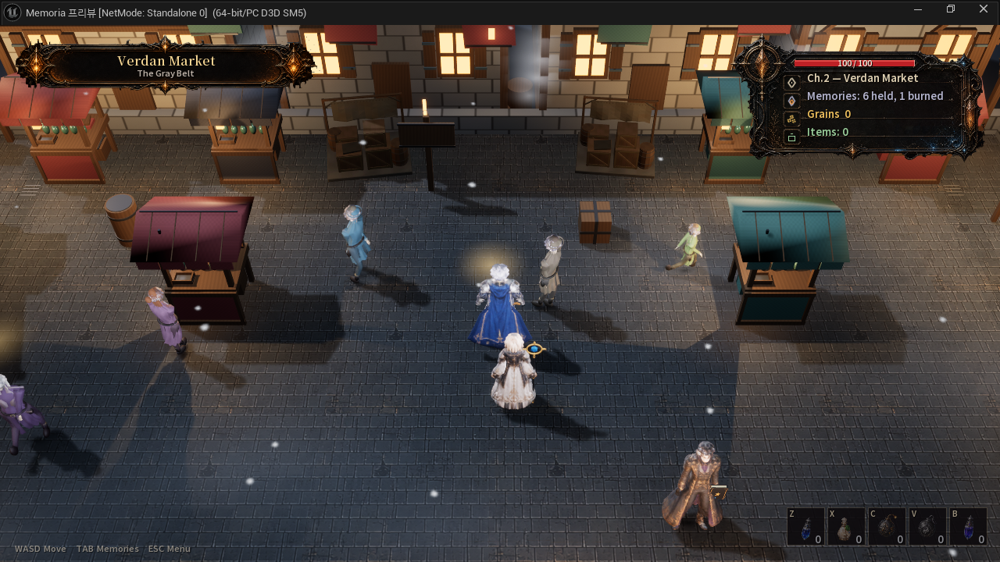
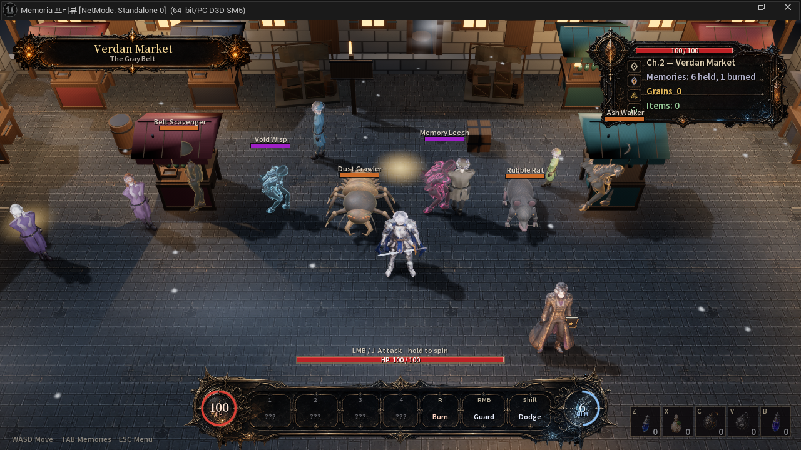
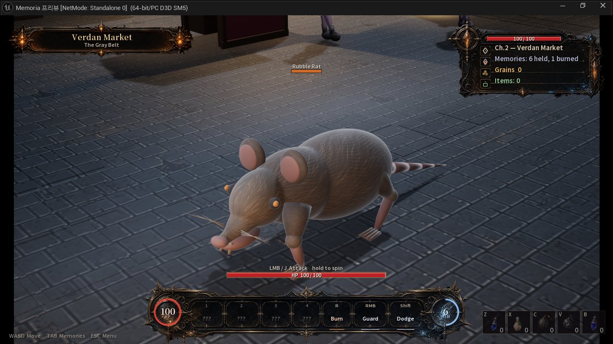
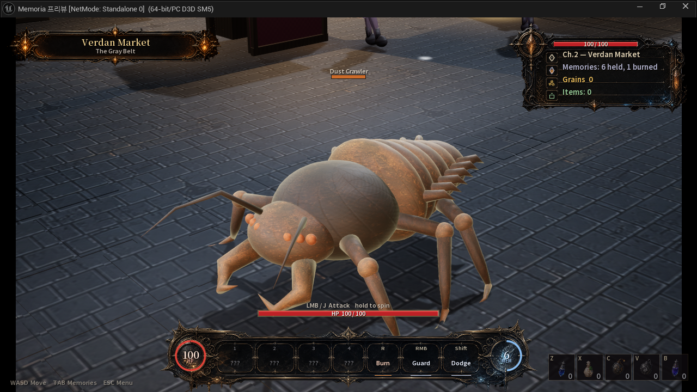

# S354 — Distinct character clothing and field creature anatomy

The user rejected the subtle S353 surface pass and asked for a clear graphics upgrade. Nine ambient NPCs now wear newly authored clothing geometry. Rubble Rat and Dust Crawler now have dedicated creature bodies, rigs and clips, replacing the shared human thief body for these two encounter kinds.

Base: `f001b6b3603329f4439869b704eb922847b04b9d`. Source/assets: `1f4d1ed4b868279d03944fc548bf2c680b2e762c`. Final fresh validation: **58/58 PASS, including all 30 rendered visual tests**. Full 274 registry was not rerun. All changes remain local; no push, peer merge or package release.

## Source authority

The [approved final manuscript hub](https://app.notion.com/p/3e5fcba683478136adbee4854f09d05f) and [worldbuilding v10](https://app.notion.com/p/3ebfcba6834781b79800d0ceac49aa64) were read live in this task. The hub covers approved final-1 chapters 1–56. Worldbuilding v10 is an integrated REVIEW; approved finals and user decisions take priority. This is visual adaptation of existing characters/encounters, with no new dialogue, narrative facts or save schema. Both new creatures retain their existing non-void classification. Only source links and metadata are retained, not copied Notion bodies. The old OneDrive GDD could not hydrate (OS389); current game contracts and the live canon references were available.

## Visible change

- Traveler, Bureauagent, Guard, Villagerf, Villagerm, Fisherman, Elder, Child and Scholar replace cylindrical clothing with fitted torso shapes, bent sleeves, split draped hems, cuffs, folded lapels, belts and pouches. Role-specific caps, brimmed hats, a bonnet, mantles and spectacles distinguish silhouettes. Painted head/hair, hands and boots remain, with modest jaw-width variation. Each new mesh reuses the exact original 77-bone bind pose and existing clips/material. Heights remain 174/176/178/165/175/172/165/120/172 cm.
- Rubble Rat has a fused continuous torso/neck/muzzle surface, ears, whiskers, incisors, four jointed legs and a six-joint tail. Its 18-bone rig drives five new clips. Dust Crawler has six articulated legs, layered carapace, mandibles, antennae and a 16-bone rig. It also has five clips. Runtime heights are 62/64 cm; HP, damage, collision box, attack timing, rush, rewards and status rules are unchanged.
- Fur and chitin use a new intact pigment atlas plus four separately generated normal/roughness data maps. Skin attenuation and weak normal strength avoid the earlier corduroy effect. Existing hit flash, species rim colour and surface/weathering controls remain bound. The pigment was created with built-in imagegen; [saved asset and exact prompt](../../Unreal/ArtSource/CharacterUpgrade/Surface/PIGMENT_PROMPT.md) are versioned. No existing painted image was edited.
- NPC meshes contain about 11–16k triangles. The continuous rat is 54,036 triangles; the crawler is 16,500. All have one body material. No GPU benchmark or additional LOD authoring is claimed.

## Native evidence

Fresh single-action UE5.8.2 build, focused 4/4 and final Foundation 6/6 plus related 52/52 pass. The final set includes all 30 registered visual tests and audio/campaign/battle-entry/shop coverage. Exact identities match; failed, notRun and inProcess are zero. Every pipeline command exits 0. Current assertions verify actual NPC replacement binding, preserved bind transforms/heights, creature mesh IDs, 18/16 bones, all five compatible clips, changing leg pose, upright body direction/height, bite playback and held death. Both live creatures report upDot=1.0. Actual pigment/normal bindings and linear vertex-colour ranges pass. New materials reject shader compilation errors.

54 focused and 78 final selected native captures are preserved at 1280×720 with SHA-256 receipts. Representative final captures are committed below. These are engine captures, not generated concept images or retouched composites.

Four technical PNGs and their manifest reproduce byte for byte in a separate output directory. All 1,233 frozen source/art/content/tool files remain unchanged after execution. Of 1,053 original tracked Unreal files, 1,049 remain identical; only four runtime/test source files changed. Original models, clips, skeletons, painted images and material packages are preserved. Claude remains clean at `159ae961f844e3492cd9857b6d472e8aa79b5d02`; original/foundation/shared model sources and Claude handoff remain untouched.

## Repairs and remaining limits

Passing tests alone did not end the work: early white pigments, floating fur and strong regular normals were visually rejected. Linear FBX colour export, a new pigment atlas, restrained normals and continuous rat anatomy replace them. A texture-build gamma assertion was fixed by waiting for texture compilation before changing settings. Blender/API/compile attempts and their logs remain in raw evidence.

Generic reimport silently chose Interchange and mixed its bind axes with legacy FBX animation imports. This visibly twisted creatures even while earlier tests passed. Those newly generated packages were archived, then all nine NPC bodies, two creatures and ten clips were freshly imported together through the original legacy pipeline. The authoring commandlet now treats generated packages as immutable revisions and imports missing packages only. Changed FBX should be rebuilt in a scratch clean import as documented in the art-source README. It does not promise in-place reimport. A first upright assertion also wrongly rejected harmless yaw; the final check measures vertical direction and height instead.

These remain stylized models. NPC facial paint is still shared; Arrel, Elia, Malet and the four other encounter variants are not resculpted in S354. Native market distance shows the clothing silhouette changes; the close creature views expose the new anatomy and material. Existing foreground stalls/HUD may overlap actors or labels. Shipping performance and the full 274 registry remain unverified.

Final warnings are retained: 15 startup Condition-failed lines per engine process; Foundation.MapInputAndModal and Campaign.CanonicalPaidRoute emit the existing r.MotionVectorSimulation render-thread warning; Chapter1Presentation emits the missing-world warning. There are 52 related memory-budget diagnostics and no foundation memory-budget diagnostics. Raw successes are Foundation 5 + 1 warning-bearing and related 50 + 2 warning-bearing. The authoring build also uses a deprecated material-usage field accepted by UE5.8.2. These warnings are not counted as clean logs.

Exact commands, identities, hashes, earlier attempts and diagnostics are in [S354_RESULTS.json](S354_RESULTS.json). Raw evidence is `Unreal/Memoria/Saved/Validation/s354/`. Root completed source/evidence/visual review; no additional agent was spawned. No editor/compiler remains and the build/GPU slot is released.
