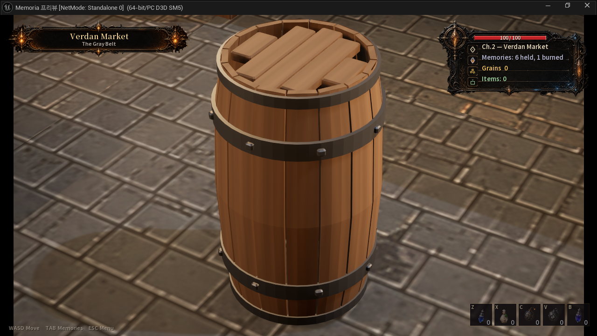
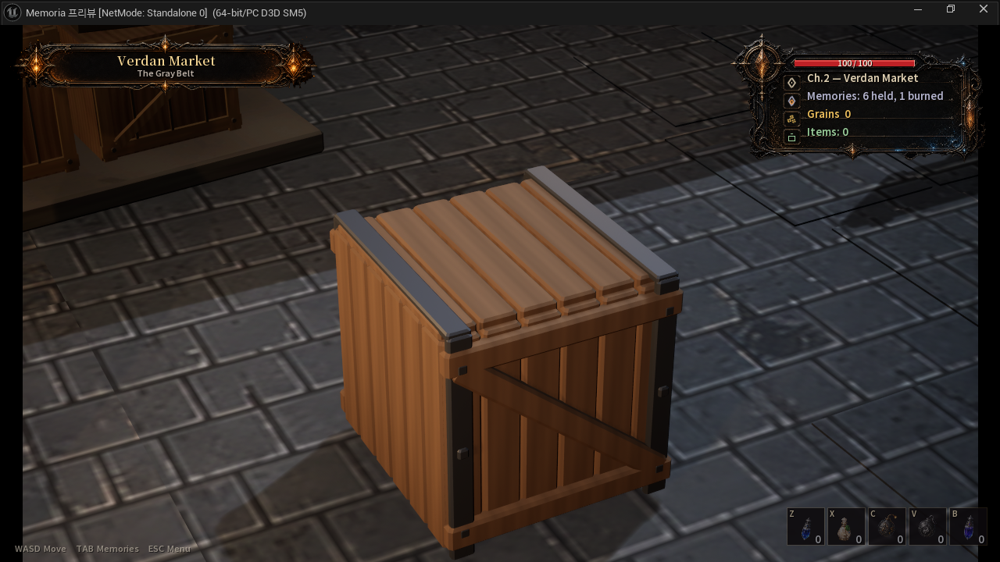
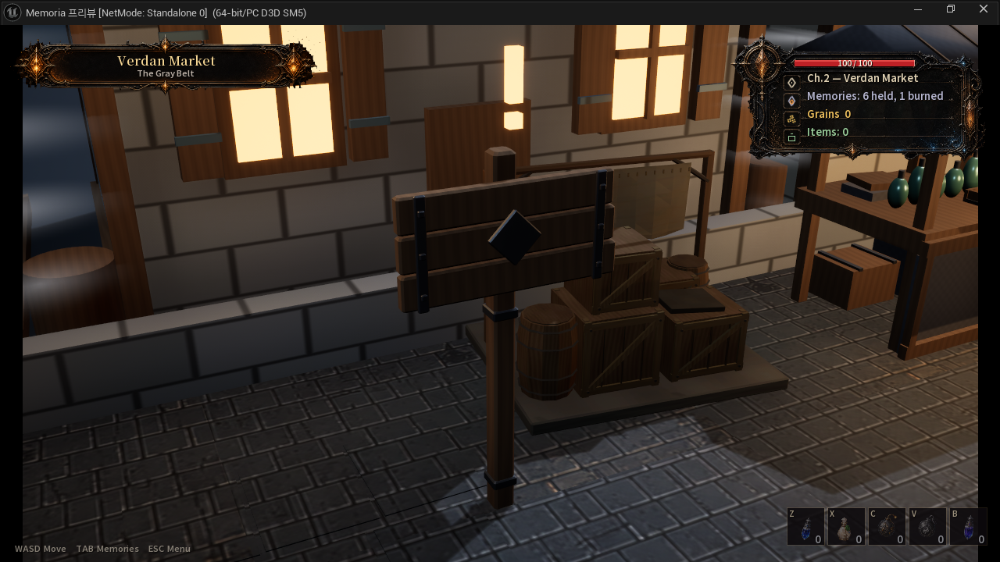
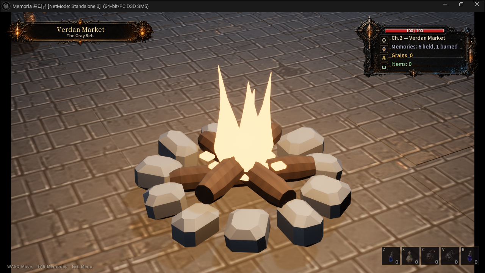

# S355 — Verdan interactive prop geometry

The Unreal graphics continuation replaces the barrel, crate, sign and campfire's primitive shapes with ten authored static meshes. Base `dc6cfd70487224343817eef9a7cb4c9a2cbe51ab`; UE 5.8.2. User-requested local commit of the implementation and evidence, with no push or package release.

## Visible result

- Barrel: sixteen curved staves, geometric seams, plank lid, four iron hoops and rivets.
- Crate: separated wall/lid planks, bevels, diagonal timber braces, straps and nail heads.
- Sign: three slightly uneven boards, forged straps, nails and a diamond fitting. Its existing unread marker remains.
- Campfire: eleven bevelled stones, three rounded charred logs, scattered embers and tapered flame lobes. Original point-light flicker and ground glow remain. Flames are stylized static geometry, not a new particle simulation.

Ten meshes contain **10,098 triangles total**, each with one material section and one live instance. Existing material packages are reused; campfire rock/charcoal use new runtime instances of the existing surface material. No collision, overlaps or navigation are added. Positions, interaction distance, rewards, HP recovery, story flags, save schema and used-container tints remain unchanged.

## Native visual review

Thirteen unedited 1280×720 engine captures are retained with SHA-256 receipts in [S355_RESULTS.json](S355_RESULTS.json): four matching before/after play views, four close review views and used-prop disk reentry. Close views use a temporary automation camera on the actual market props; the playable camera is unchanged. They do not move Arrel or alter run state. Gameplay frames can partly hide small props behind characters or the HUD. The first passing run's barrel close view was obscured by a canopy; review cameras were reframed and the related52 suite rerun. Original views/reports remain in raw evidence.

## Fresh validation

- Baseline: 30/30 rendered visual tests before source changes.
- Final: **58/58** — Foundation 6/6 and related 52/52, including all 30 rendered visual tests. Exact registered identities checked; failed/notRun/inProcess are zero. Build, fixture, audio-source, story-source and automation commands exit 0, with no fatal diagnostics.
- The real market test checks all ten loaded mesh identities, anchors/scale, material count, triangle/footprint bounds and nonblocking behavior. Existing tests still exercise separate spent tints, all four interactions, real HP recovery, repeat-use rejection and disk save/reentry. Run, memory and narrative trace remain unchanged by presentation checks.
- Existing architecture retains its under-40 batch bound; the ten independently asserted new prop batches are counted separately. No performance benchmark, added LODs, cooked package or full 274-test registry is claimed.

Logs are not warning-free:
- baseline: 28 success + 2 success-with-warning; 15 startup Condition lines, 0 memory-budget diagnostics.
- related: 50 success + 2 success-with-warning; 15 startup Condition lines, 0 memory-budget diagnostics.
- foundation: 5 success + 1 success-with-warning; 15 startup Condition lines, 0 memory-budget diagnostics.
The exact warning events and raw command/log paths are recorded in results. Existing MotionVectorSimulation/missing-world warnings and the deprecated GetInputsView build warning remain. No unrelated warning cleanup was attempted.

## Ownership and reproduction

Only two previously tracked Unreal source files changed; ten new packages and the new authoring commandlet are added. Existing character, animation and material packages are unchanged in Git. Claude remains clean at `159ae961f844e3492cd9857b6d472e8aa79b5d02`. Root reviewed the source diff and native captures; no separate agent was spawned.

Authoring: build MemoriaEditor, then run `UnrealEditor-Cmd.exe Memoria.uproject -run=MemoriaMarketProps -unattended -nop4 -nosplash -NullRHI -stdout -FullStdOutLogOutput` in a scratch project with the existing material dependencies and without MarketPropsS355 packages. The commandlet refuses to overwrite any existing target package. Changed geometry should use a new revision or an isolated scratch generation; it is not an in-place reimport tool.

The initial mistaken Godot source changes were reversed before this Unreal pass; the eleven relocated legacy conflict files were restored with matching hashes. Diagnostic files remain separate. Original Godot production source, foundation, shared models and Claude handoff were not used for this implementation.

Raw evidence: `Unreal/Memoria/Saved/Validation/s355/`; final receipts above. Build/GPU slot released after own processes exited.
