# S356 — items, characters and three exploration regions

MEMORIA's Unreal graphics pass replaces small item symbols, generic character silhouettes and plain architecture with original paintings and authored geometry. Base `a44cc8151928b4542321eb7f3ac258870348128f`; UE 5.8.2. The implemented exploration regions are Verdan, Belt Waystation and Drift Shelter. This does not port the ten legacy Godot maps.

## Visible changes

- Six original transparent item paintings: Potion, Hi-Potion, Antidote, Firebomb, Smoke Bomb and Witness Ink. The five quick slots have larger artwork, category seams, keycaps and count seals. Z/X/C/V/B, automatic healing selection, cooldowns, quantities and effects retain their existing behavior.
- Elia retains her complete embroidered dress and gains an open-front travelling cape, satchel and small fittings. Malet retains his complete dark/gold merchant coat and gains bounded trading accessories. Faces remain unobstructed. Original body geometry, UVs and painted materials occupy slot 0; separate accessory colors occupy slot 1. The original 77-bone bindings and heights are retained.
- Ash Walker gains a torn mantle, calcified ribs, burnt crown and a faceless mask with fitted brow/cheek relief; Belt Scavenger gains shoulder plates, pack and greaves with an exposed source face. Both remain stylized, low-detail humanoids with simpler facial surfaces than the painted hero; the native review accepts connected, readable heads and distinct equipment rather than high-fidelity character art. Ten directly authored compatible clips replace the inherited humanoid clip problem. Their original frame rates, frame counts and play lengths are preserved. Base Husk and Thief use these same safe clip roles.
- Void Wisp has a fractured nucleus, crown and six articulated tendrils on a 20-bone rig. Memory Leech has a continuous arched annelid body, annuli, sucker jaw, hooked teeth and palps on a 12-bone rig. Ten dedicated clips and a dark crystal/leathery skin atlas distinguish the two creatures.
- Thirteen architecture meshes add tiled roofs/eaves, recessed doors, shutters, sagged sewn canopies/ropes, stone courses, chipped caps, rubble and tufts. The kit contains 27,673 triangles. Verdan receives market/building detail; Belt and Drift receive weathered masonry and shelter rigging. Existing concrete slabs now show the new stone surface at the same transforms.

There are 56 new packages: 6 item textures, 15 environment packages and 35 character packages. New architecture instances have no collision, overlaps or navigation. Physical blockers, routes, interactions, story flags, save schema, combat values, attack timings, status rules and rewards are retained.

## Native evidence

Before/after images are unedited 1280×720 engine captures. Close character views use automation cameras; the playable camera is unchanged. Exact source paths, image hashes, dimensions, test identities and raw logs are in [S356_RESULTS.json](S356_RESULTS.json).

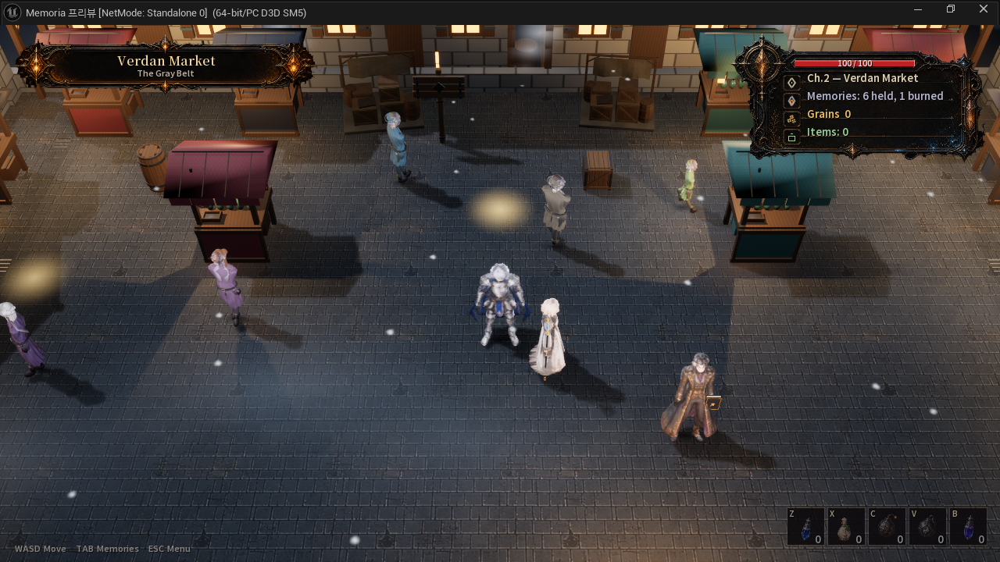
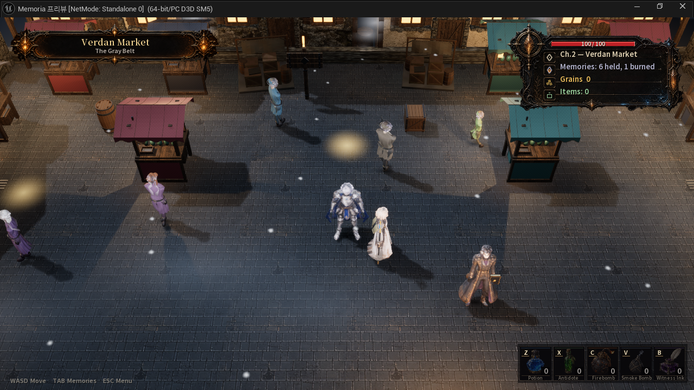
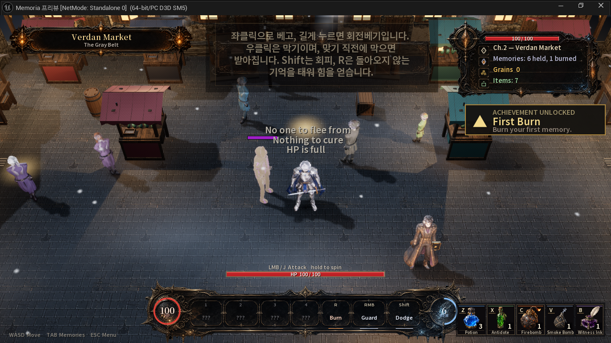
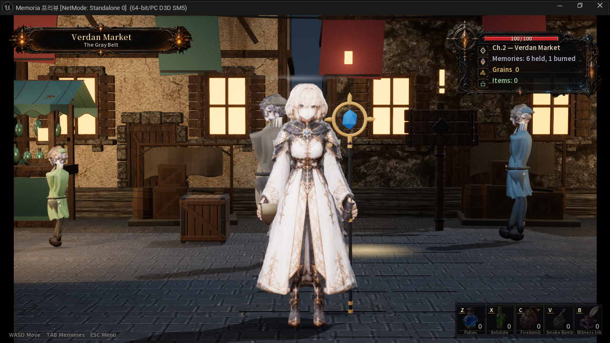
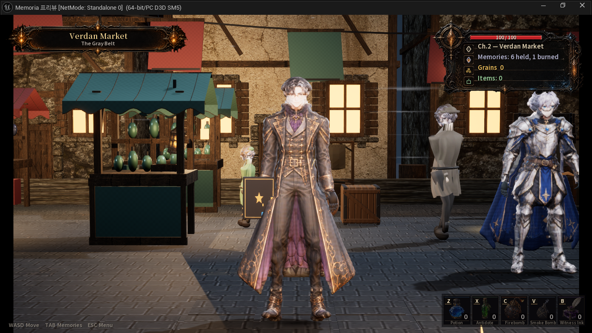
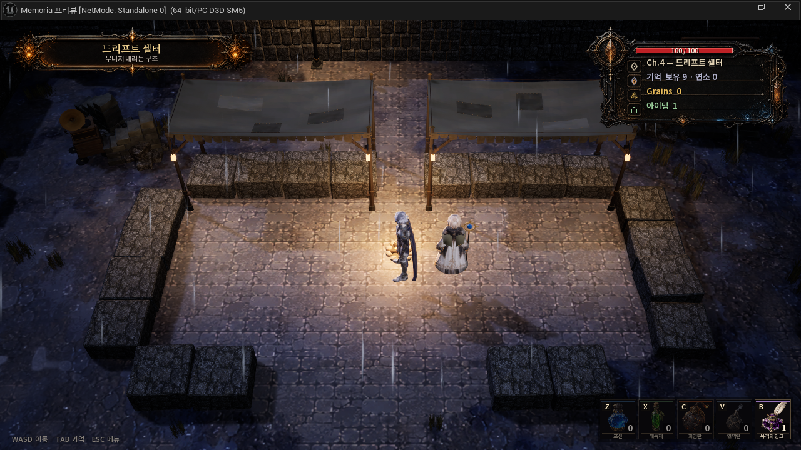
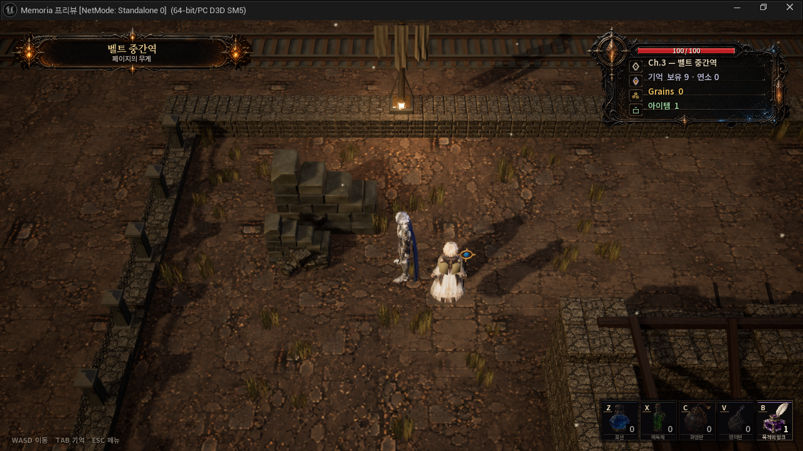
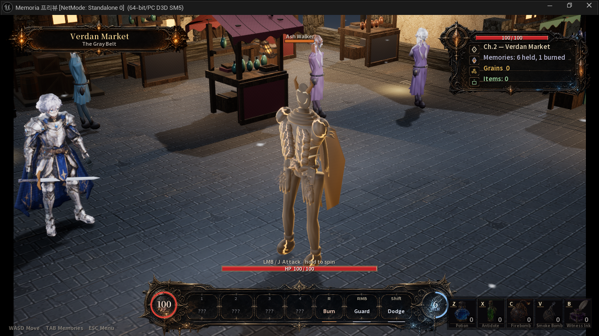
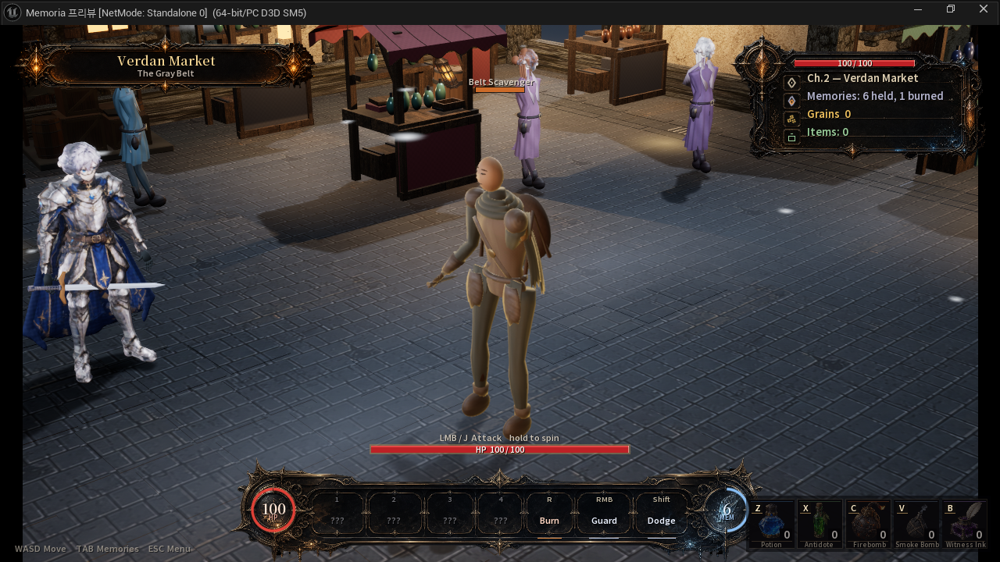
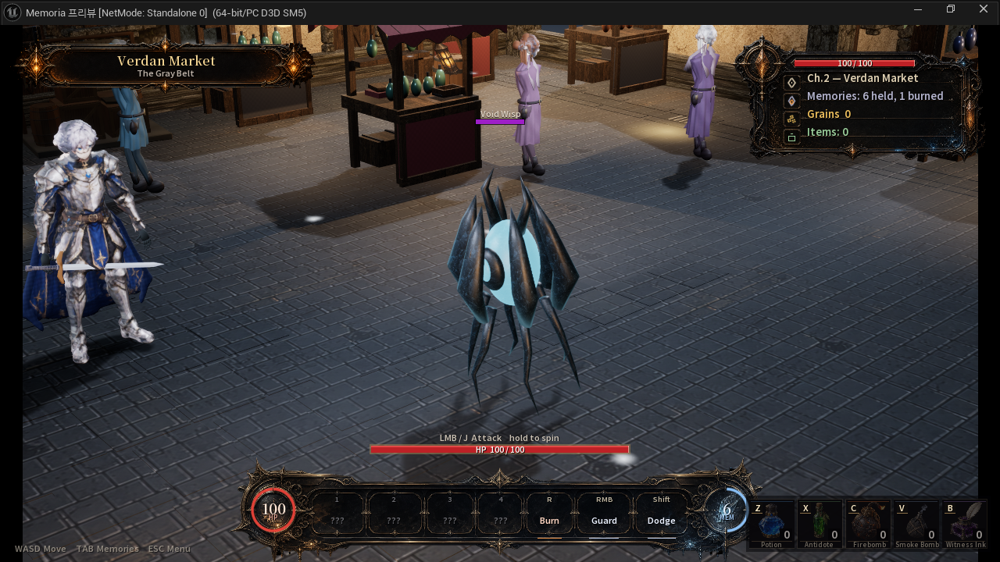
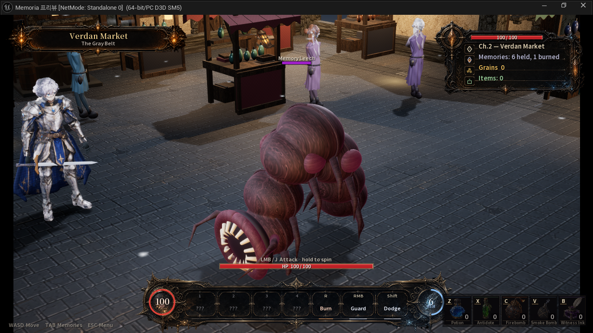

## Validation

Fresh UE 5.8.2 build and immutable import passed. Focused acceptance: **4/4**. Final rendered visuals: **30/30**. The `Memoria.` registry has **274/274 distinct identities validated across two rendered sessions**: 122 fully completed Success records with matching, error-free BeginEvents/EndEvents blocks from the interrupted run, plus 152 exact missing identities in a fresh native report. Combined with the 30 visual identities, acceptance covers **304 unique registered identities**. Every accepted identity is Success with zero errors; failed/notRun/inProcess are zero in the final visual/native-resume reports. The final visual pipeline commands and resumed native process exit 0 with no fatal diagnostics. Focused tests are a subset and are not added to the total.

The coordinator stopped the original rendered functional session after 122 completed identities because frame-driven NPC movement made its 1800-second deadline insufficient. Its nonzero exit, original AUTOMATION_FAILED receipt and raw log remain preserved. Only fully closed successful test blocks count; the original pipeline is never relabeled PASS. The remaining 152 identities ran with the same offscreen rendering, MemoriaCapture and 1280×720 flags. This is an aggregate registry result, not one uninterrupted full-suite pipeline PASS.

A separate NullRHI attempt failed the rendered viewport and real widget texture-brush assertions, then exited 3 after FMaletReplay::Update accessed index 0 of an empty array at MemoriaMaletTests.cpp:606. This unsupported rendering-mode/test-harness failure and its fatal diagnostics are preserved under full-nullrhi-failed. None of its test results count toward acceptance; the harness was not weakened to make that mode pass.

Independent source and native review passed. The humanoid foes still have smooth stylized tan surfaces and simpler facial detail than the painted hero and named NPCs. The accepted improvement is distinct equipment, connected heads and repaired deformation, not high-fidelity humanoid character art.

Logs are not warning-free. MotionVectorSimulation/missing-world warnings and deprecated GetInputsView/build diagnostics remain. Test warning events and log diagnostic occurrences are reported separately below; historical failed attempts retain their actual exits and fatal diagnostics.

- baseline: 28 success + 2 success-with-warning.
- visual-final: 28 success + 2 success-with-warning.
- Original 122 completed rendered identities: 7 tests with warnings, 7 closed-block warning events. The interrupted pipeline remains AUTOMATION_FAILED.
- Resumed 152 rendered native identities: 151 success + 1 success-with-warning; 1 native warning events.
- baseline/automation: exit 0; log warning lines 4, Condition-failed occurrences 15, memory-budget occurrences 0, deprecated occurrences 0, fatal lines 0.
- visual-final/automation: exit 0; log warning lines 4, Condition-failed occurrences 15, memory-budget occurrences 0, deprecated occurrences 0, fatal lines 0.
- full-rendered-interrupted/automation: exit 4294967295; log warning lines 14, Condition-failed occurrences 15, memory-budget occurrences 0, deprecated occurrences 0, fatal lines 0.
- full-resume/automation: exit 0; log warning lines 2, Condition-failed occurrences 15, memory-budget occurrences 0, deprecated occurrences 0, fatal lines 0.
- full-nullrhi-failed/automation: exit 3; log warning lines 1, Condition-failed occurrences 15, memory-budget occurrences 0, deprecated occurrences 0, fatal lines 2.
- build-heads/editor_build: exit 0; log warning lines 0, Condition-failed occurrences 0, memory-budget occurrences 0, deprecated occurrences 0, fatal lines 0.

The character tests measure actual CPU-skinned body vertices during real hit, natural recovery, walking, strike and held death. Humanoid head checks require preserved alpha-zero painted vertices weighted to the head hierarchy, with nonzero extent near the actual head socket. A hood or imported static bounds cannot substitute for a visible head. Base Husk/Thief hit and recovery are checked too. Item checks inspect all six live textures and actual selection/use. Environment checks verify live bindings, mesh/instance counts and original blockers/transforms.

Earlier attempts are preserved. The first character import omitted `-AllowCommandletRendering`; its four partial packages were archived. A subsequent passing import had face paint on garments and excessive creature glow. The refined run exposed a real inherited hit-clip failure: all human foe vertices collapsed to the actor origin with zero extent. New original-rig clips repair the source; the replay was not reset to hide the bad pose. Final import logs compare old zero root/head scales with new unit scales and assert original clip durations. The first Final focused run passed 4/4 but was visually rejected for lost NPC tailoring and obscured humanoid heads. All 35 packages and 109 captures were archived. Accepted restores complete NPC bodies/materials. A second passing focused run exposed a detached Scavenger head binding and hidden Ash mask relief; the two superseded meshes were archived. HeadRefinement removes the floating binding, conforms face relief to the source surface and seats the Ash crown on its mask. The 33 accepted dependencies and all safe clip sources remain unchanged. The source explicitly described Husk as faceless, so its earlier black opening was an inherited design rather than a missing human face. A separate test assumption about the original architecture normal input was corrected to compare against its actual null graph state. Rejected geometry, packages, captures and raw failed reports remain under `Saved/Validation/s356/`.

## Source and reproduction

Eight original images were generated using built-in imagegen: six 1254×1254 RGBA item cutouts, one 1254×1254 RGB four-panel architecture atlas and one 1254×1254 RGB supernatural atlas. Original PNG bytes and exact prompts are retained; no raster enlargement, cropping or retouching was used. These are painted albedo images, not measured PBR data.

- [Item sources and prompts](../../Unreal/ArtSource/ItemsS356/README.md)
- [Architecture atlas and prompt](../../Unreal/ArtSource/EnvironmentS356/README.md)
- [Character authoring, rig, geometry and import instructions](../../Unreal/ArtSource/CharacterUpgradeS356/README.md)

Blender 4.5.3 authors the FBX sources. Character import explicitly uses the legacy FBX pipeline with consistent axes and bind handling. All import commandlets preflight their complete target sets and refuse existing packages. Reproduce in a disposable scratch checkout or a new revision; do not reimport into accepted immutable packages. Material authoring requires `-AllowCommandletRendering -RenderOffscreen`. Reproduction runs the default base generator/import for 33 Accepted packages, then the separate `-- Heads` generator and `-HeadRefinement` import for two final meshes. The character source README records the source-preparation checkpoint; the completed fresh native acceptance and final suites are recorded here.

All 564 original tracked Content packages match their frozen SHA-256 values. All 21 accepted item/environment packages and all 485 executed source/art/package files match their pre-test hashes. Claude remains clean at `159ae961f844e3492cd9857b6d472e8aa79b5d02`. Original Godot, foundation, shared source bundles and Claude handoff were kept read-only. Disjoint character/environment/item owners prepared source in parallel; root serialized Blender/build/import/render. Independent source and native reviews were used; earlier passing humanoid/NPC visuals were explicitly rejected, then fixed and freshly rerun. Local task commit only; no remote push, peer merge/message or release.

No Shipping package, new LODs or performance benchmark is claimed. Native captures demonstrate this development build; general animation quality and smaller-screen UI readability remain ongoing art polish areas. Existing engine/build warnings are recorded explicitly in the results rather than described as warning-free.

Commit preparation verified 155 scoped files, all 56 new package LFS pointer OIDs/sizes against the actual bytes, 74 exact filtered source/capture files, a clean staged whitespace check and unchanged executed/original hashes. The detailed attestation is retained in S356_RESULTS.json.

The initial staging check detected Git CRLF-to-LF filtering in eleven new character JSON sources and the generator. S356-only Git attributes now preserve the original authored bytes, including Windows CRLF; the new source paths were re-added with those attributes. All 74 source/capture candidates now match the staged bytes exactly. No frozen source, asset or executed code byte was changed. Existing LFS and legacy path rules remain unchanged.
