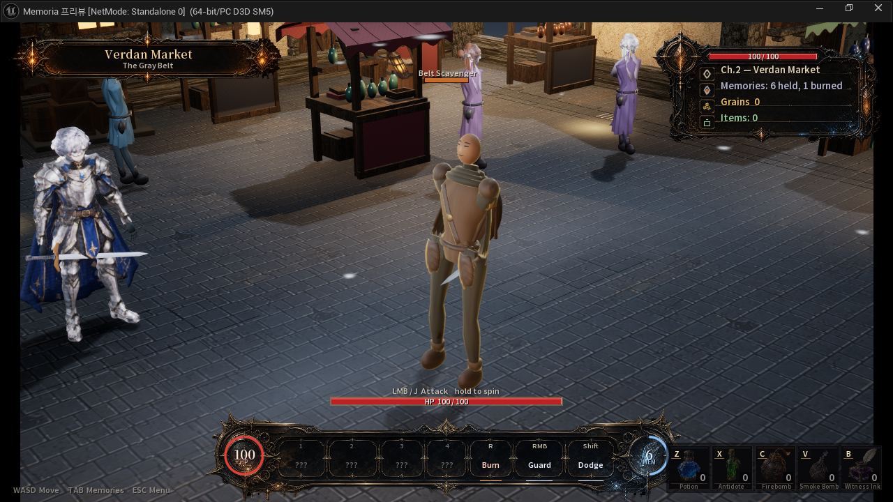
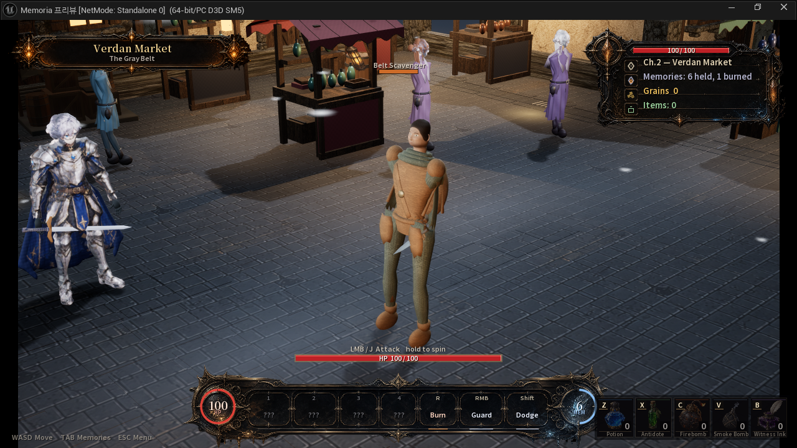
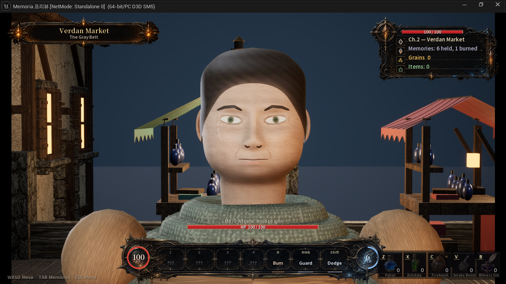
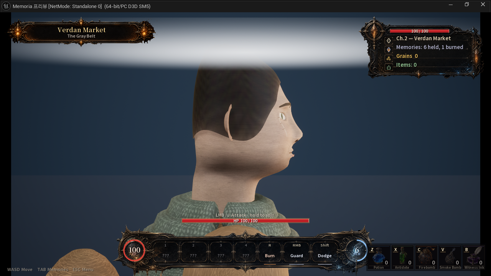
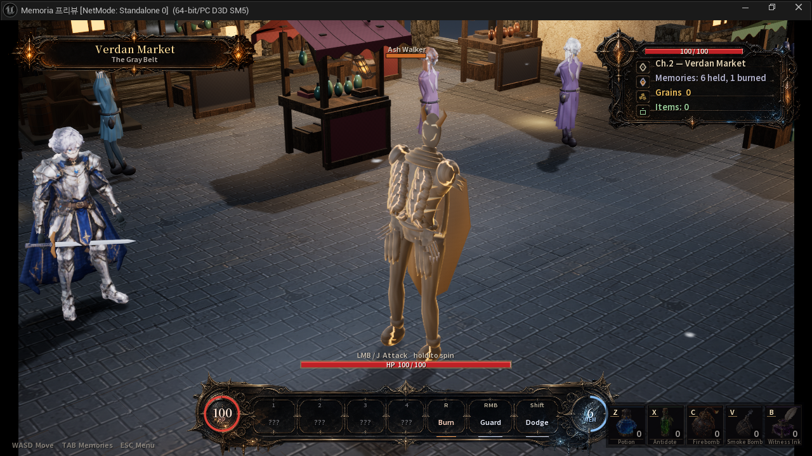
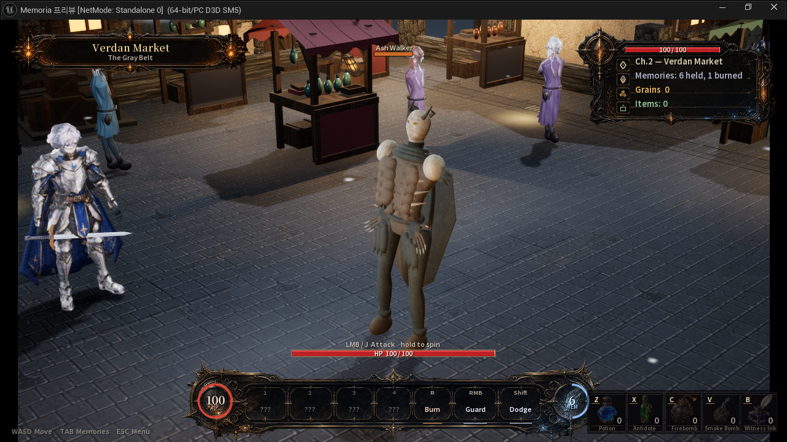
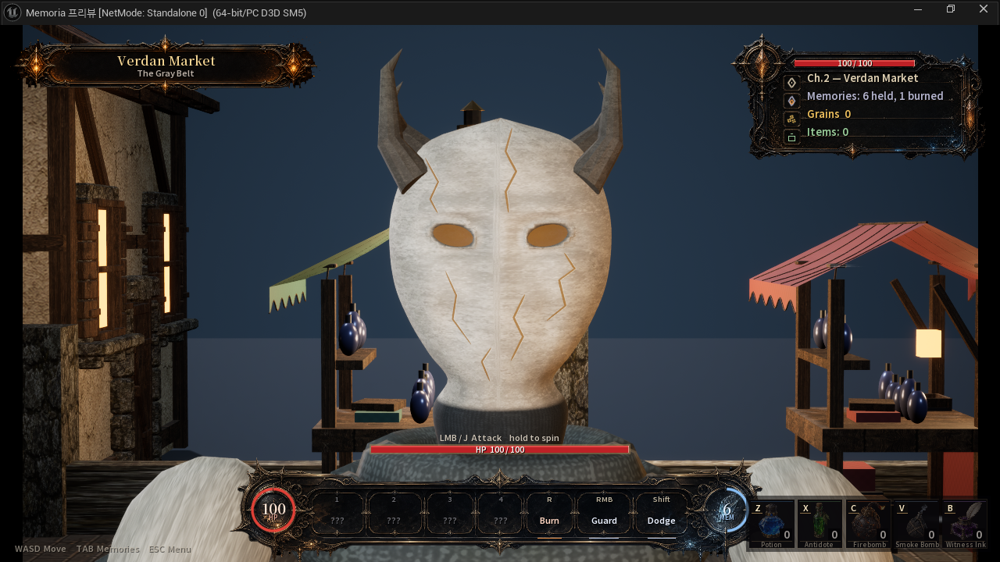
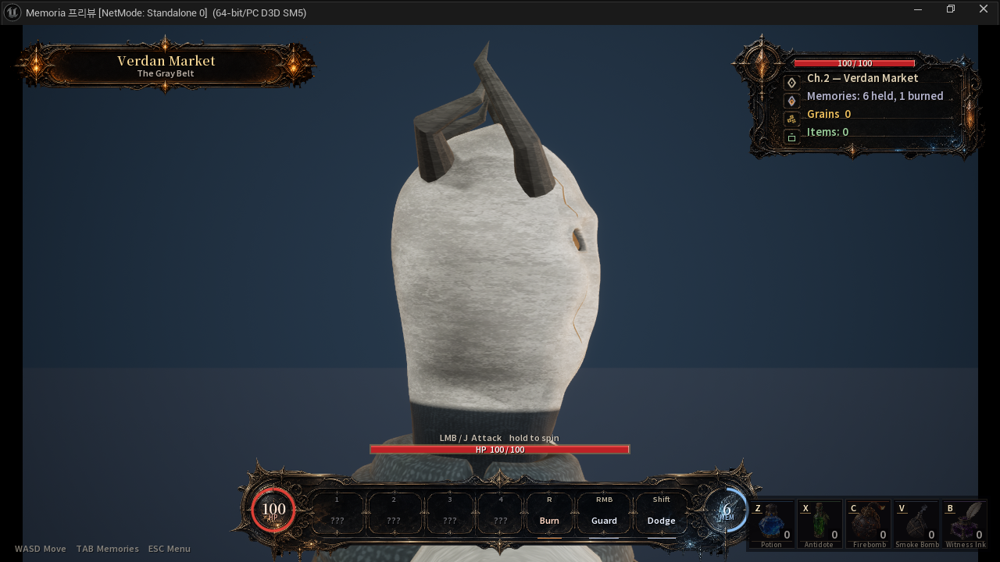
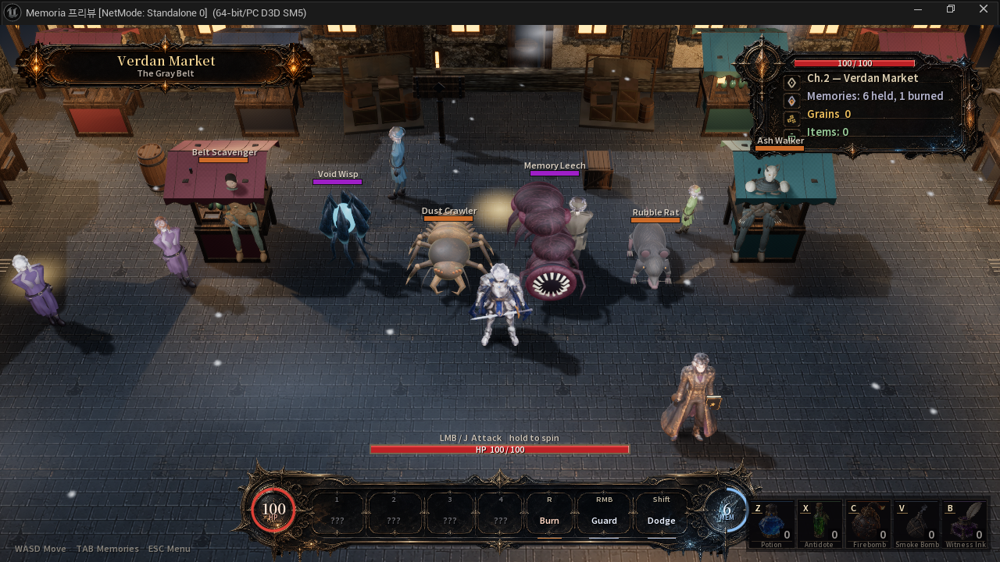

# S357 — sculpted humanoid faces and physical material regions

The smooth oval heads of MEMORIA's humanoid foes now have authored facial anatomy and material detail. This Unreal 5.8.2 presentation change starts from `9eea3f506352e93137933ca69628a0ad871b9036` and accepts immutable **R4** assets. It refines two mesh families used by **Ash Walker/Husk** and **Belt Scavenger/Thief**.

## Visible changes

- Belt Scavenger has shaped eye openings, fitted eyelids and iris/pupil geometry, brows, a rounded nose with nostrils, compressed lips, cheeks, jaw, ears, close-cropped hair, beard shading and an old cheek scar.
- Ash Walker has hollow sockets, calcified facial planes, fitted cracks and rooted crown prongs. Its established faceless husk design remains; no human eyes or mouth are added.
- Three sections separate body, equipment and the complete new neck/head. Vertex albedo and categorical regions distinguish skin, ash/bone, leather, cloth and metal. One original four-strip atlas supplies restrained surface variation; existing normal sources are reused. Roughness and metallic response are region-specific. Hit, rim, weathering and the ash glow/crack controls remain connected to all live slots.
- Existing 77-bone names, hierarchy, bind pose and S356 safe clips are retained. Only the mesh lookup is redirected for the four humanoid identities. Numerical height, movement, combat values/timing, rewards, collision, routes, save and narrative logic remain unchanged.

The old head components and one **32-vertex rigid neck cylinder** per source are replaced by a continuous blended neck/head. Exact removed bounds are recorded in each geometry receipt. Every other body/equipment coordinate, UV corner and skin weight is checked unchanged. Ash Walker has 30,172 triangles; Belt Scavenger has 34,464. New head features follow the existing head rig; this is a static sculpt improvement, not a facial animation/blendshape system.

## Actual Unreal views

These are unedited engine captures at 1280×720. The close views use test cameras; the playable camera and scene lighting are unchanged. Before/after detail views use the same established framing. The inherited lineup fixture partly overlaps the humanoids with market canopies, and some base-foe views have tutorial HUD occlusion. Those frames are context only; unobstructed individual Detail and FaceFront/Profile views establish facial quality.

## Fresh validation

- Baseline FieldFoes/FoeVariety **2/2** before the new build. Final editor build and clean legacy FBX import exit 0; six actual material shaders compile. Exactly **9 new packages**: two skeletal meshes, six materials and one texture.
- All **30 visual + 6 Foundation tests = 36/36 unique tests** in the final rendered run, including both focused tests after correction of their stale material assertions. The earlier focus was 1/2 and remains recorded as failed. Final counts: 34 success, 2 success with warnings, failed/not-run/in-process 0. Final process exit 0, fatal diagnostics 0.
- Real CPU-skinned body and face geometry are checked independently during hit, natural idle recovery, walking, strike and held death. Dense new face geometry cannot outvote collapsed old body geometry. Actual imported RGBA buffer values, original binds, UVs, per-slot materials and visible head volume are verified.
- Blender verifies each component's UV/color values, every retained body/gear corner, actual stitched eye boundaries and fitted surface details, then a fresh LINEAR FBX roundtrip. Source/import/native reviews inspect front, profile, ordinary gameplay and combat/death views.
- All **619 pre-existing packages** retain their frozen SHA-256 values. All 292 inputs frozen before the final rendered run remain byte-identical. Original Godot/foundation, peer checkout and shared model sources remain read-only.

Warnings are retained in [S357_RESULTS.json](S357_RESULTS.json), including the helper's UE `GetInputsView` deprecation warning, engine warnings and asset compilation memory-budget diagnostics. No warning-free build is claimed. No full 274-test story registry rerun, Shipping package, new LODs or performance benchmark was performed. The art remains stylized; retained body proportions and general animation polish are outside this face revision.

## Corrected attempts and reproduction

R1 was rejected before Unreal import: Blender CustomData allocation invalidated a saved UV RNA reference, so UV writes overwrote RGBA. R2 retrieves both layers after allocation and adds value/roundtrip checks. R2 was then rejected for hair-crown and brow intersections. R3 fixes those and rounds the nose, but actual triangle diagnostics found 77 sampled eye-border holes and intersecting nostril/crease surfaces. R4 uses the actual triangulated skin to fit details and connects eyelids to exact cut boundaries. Its first authoring run exited 2 when the new ray check found the two tiny uncapped eye centers, before writing any FBX; explicit triangle fans close those centers, and the assertions remain enabled. The first complete R4 source then exposed a stepped light border from separate cranium/lid normals. It was archived intact before the final seam-weld candidate, preserving all old body normals and corner data. No Unreal package was created before this final source was accepted. Earlier source/preview/diagnostic evidence is retained under `Unreal/Memoria/Saved/Validation/s357/`; none of R1–R3 was imported as game content. A stale R1 test path found by read-only review after the R2 build was replaced with the shared mesh-path helper before native testing.

The first native focus run retained a failed FieldFoes result: twelve old normal assertions either requested overridden-only MID values or still expected strength 1.0. The corrected test reads effective inherited strengths (0.08 Face, 0.14 Body/Gear) and also follows the actual Normal graph to the original normal texture and DetailStrength. FoeVariety and actual pose/color/geometry checks had already passed. Meshes, runtime and packages did not change for this test fix; a fresh build and the final 36-test rendered run, which includes both focused tests, followed.

Ash Walker's source contains 30,172 triangles; Unreal retains 30,124. The difference matches 48 zero-area triangles at four crown tips identified by a read-only FBX analysis. Their valid companion triangles retain the closed tips; the socket center fans have nonzero area. Native views show intact crown tips and eye surfaces. The exact importer removal locations are inferred from those counts, not directly matched index buffers.

Source, geometry receipts and instructions: [HumanoidFacesS357/README.md](../../Unreal/ArtSource/HumanoidFacesS357/README.md). `SurfaceAtlas.png` is an unchanged **1254×1254 RGB built-in imagegen** original, with exact prompt and provenance in [generation_prompts.json](../../Unreal/ArtSource/HumanoidFacesS357/generation_prompts.json). It is diffuse artwork, not measured PBR data. No raster resizing, cropping or retouching was used.

The generator and commandlet refuse existing immutable targets. Reproduce only in a disposable scratch copy with the new source/output target directories absent, or explicitly author a new revision. Import uses `-run=MemoriaHumanoidS357 -Revision=R4 -AllowCommandletRendering -RenderOffscreen`, with the legacy FBX factory, original skeletons and fixed axes. Fresh exact commands, hashes, test identities, all selected captures and raw log locations are recorded in [S357_RESULTS.json](S357_RESULTS.json).

Root serialized Blender, build, import and render. Disjoint geometry/test work and independent source/native reviews were used. Local task commit only; no remote push, peer merge/message or release.
