# S358 — NPC 의상과 인간형 몬스터의 전체 형태 개선

2026-10-15, Unreal 5.8.2. 기준 커밋은 `f816e6fbe355fa4107613b826ea1db11a93381cb`, 최종 원본·패키지는 **R3**입니다. 일반 NPC 9종과 엘리아·말렛, 인간형 몬스터 2개 모델 계열(4개 적 ID)에 새 모델 13개를 연결했습니다.

- 인간형 몬스터: 구형 어깨와 단순 몸통·팔다리를 허리선이 있는 조끼, 층을 나눈 어깨 장식, 굽혀지는 소매·바지, 손목 보호대, 장화·끈, 갈라진 외투 자락과 버클로 다듬었습니다. Ash Walker의 기존 흉곽 장식과 Scavenger의 장비, S357 얼굴·목, 손과 발은 유지됩니다.
- 일반 NPC: 소매 주름·소맷단, 말린 옷깃, 장화·끈, 단추와 직업별 앞치마·어깨 장식을 추가했습니다. 목의 늘어진 연결부도 연속된 곡면으로 교체했습니다. 엘리아·말렛은 기존 의상 그림이 보이도록 뒤쪽 장식의 테두리와 끈을 보강했습니다.
- 원래 그림·재질·77개 뼈·애니메이션을 재사용합니다. 새 이미지·재질·텍스처는 생성하지 않았습니다. 이동·전투 수치, 충돌, 이야기와 저장 로직은 그대로입니다.

## 실제 Unreal 화면

1280×720의 편집하지 않은 네이티브 캡처입니다. 몬스터 전후 화면은 기존 비교 카메라를 사용하며, NPC 개별 화면은 검사용 카메라입니다. 게임 카메라와 조명은 바꾸지 않았습니다.

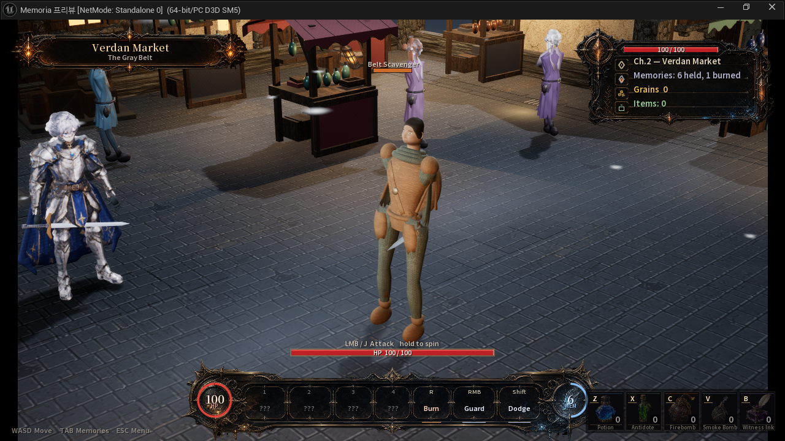
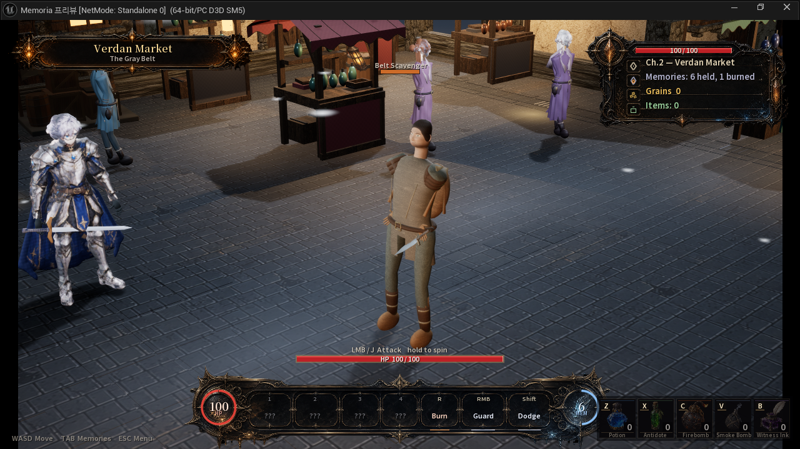
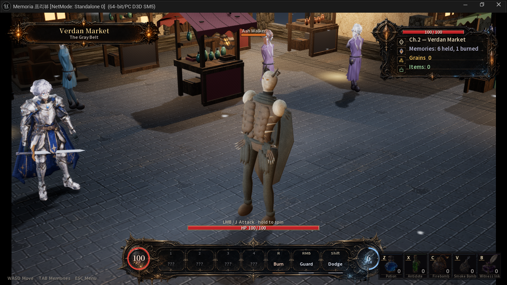
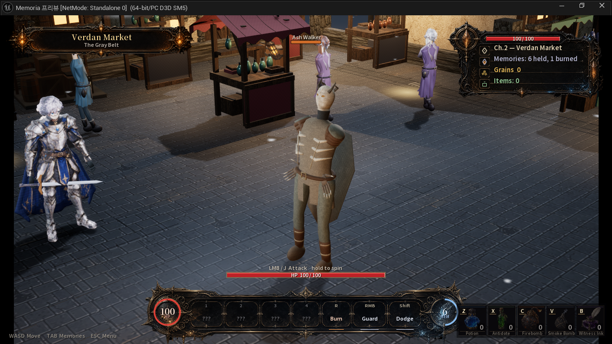
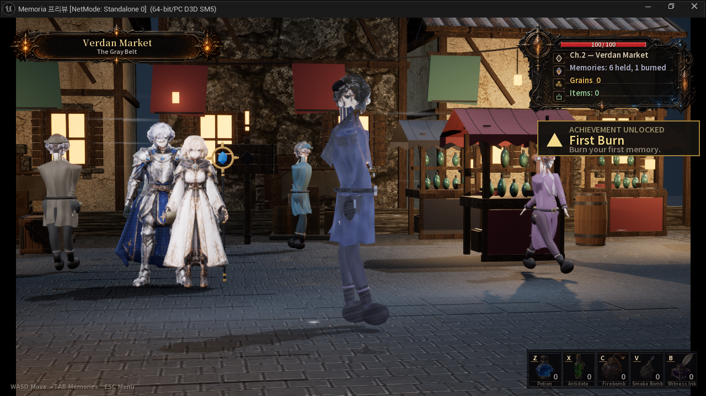
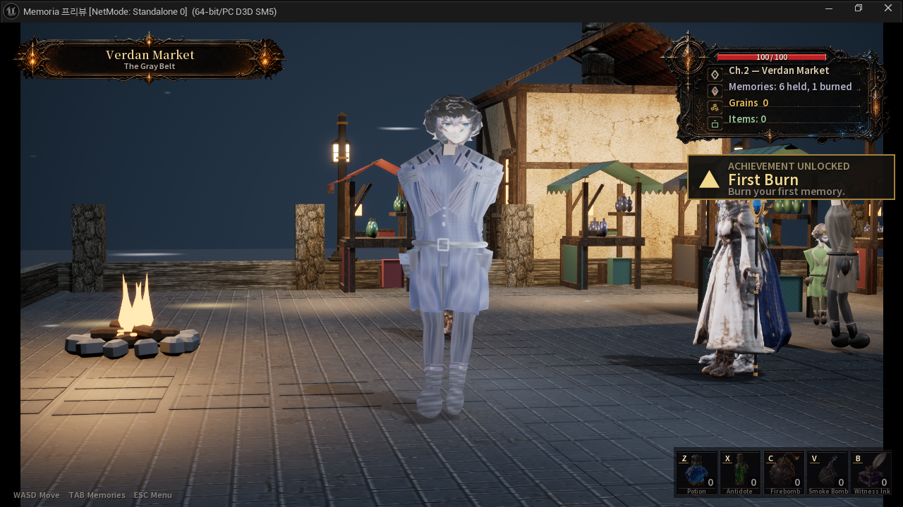
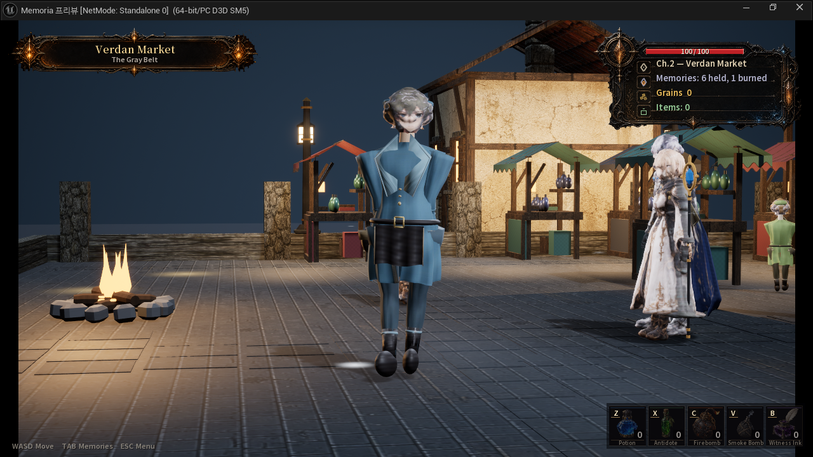
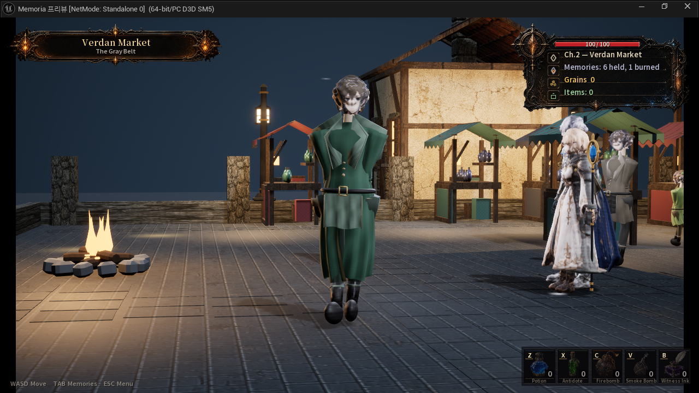
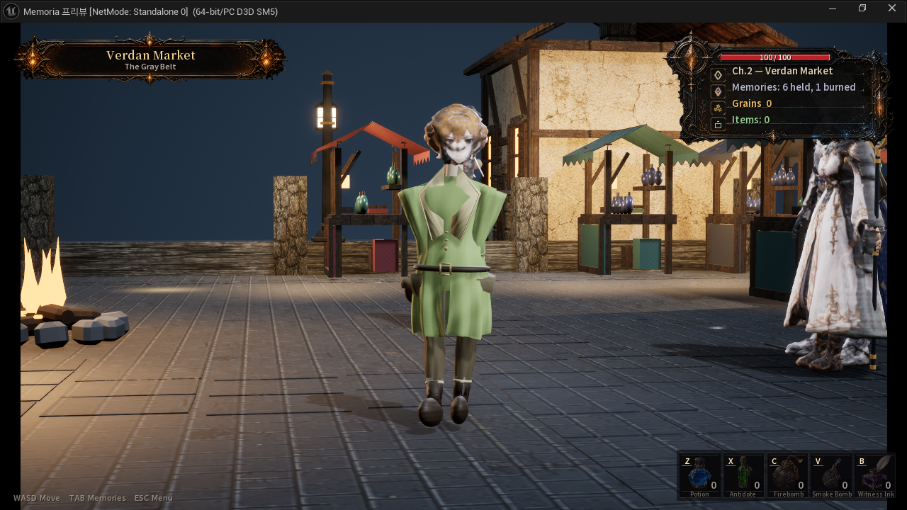
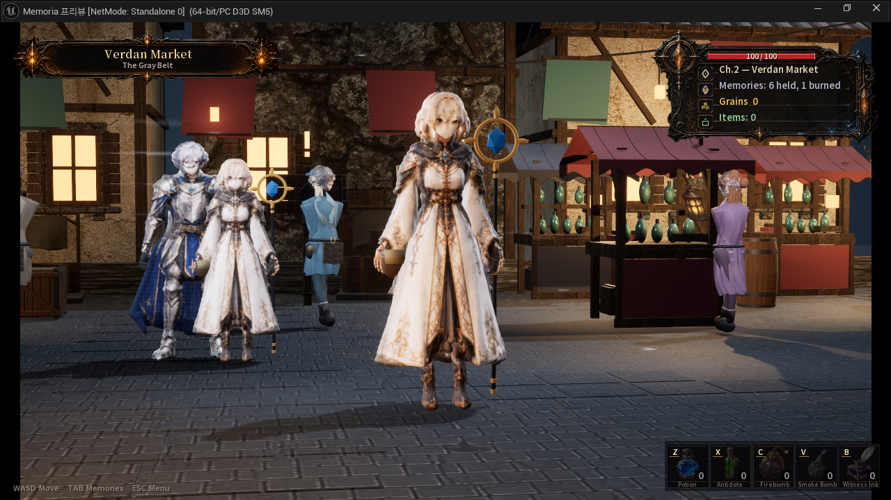
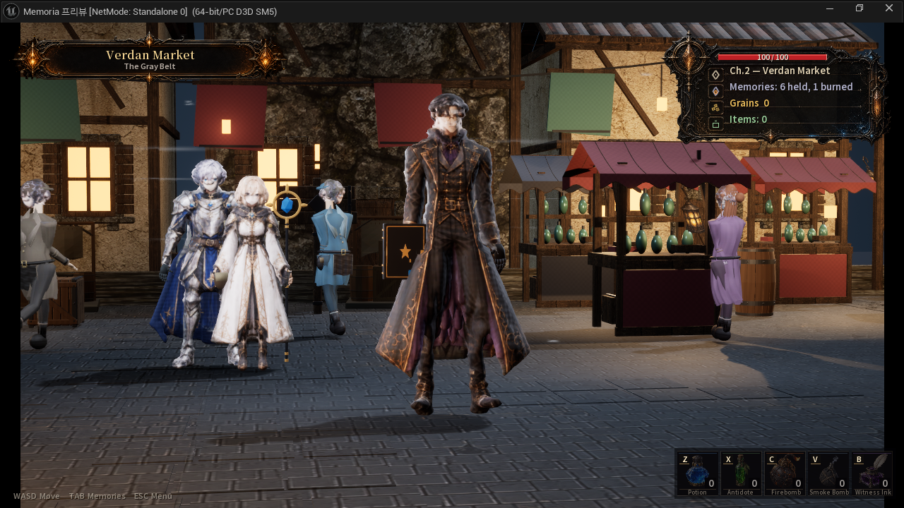
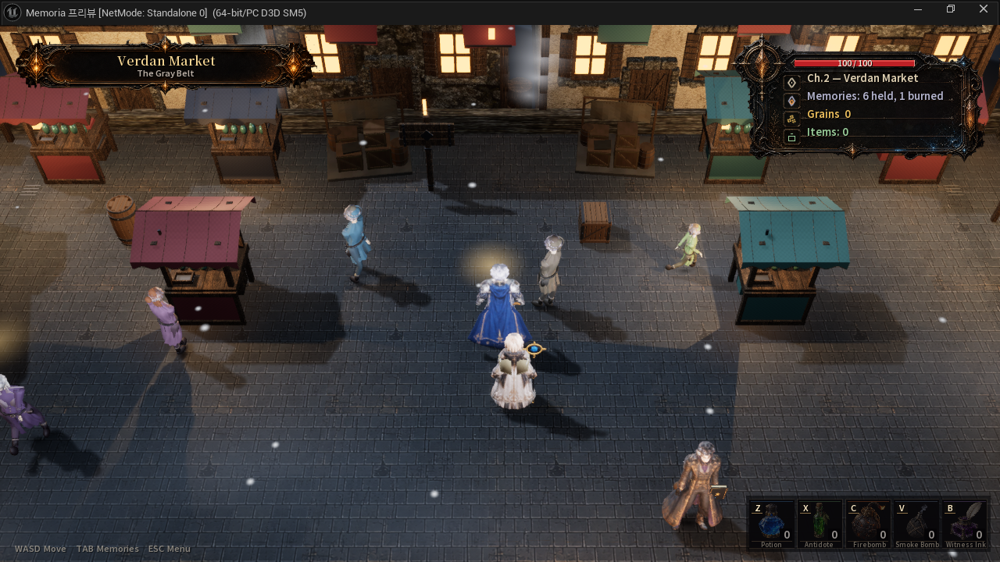

## 검증과 보존

- 변경 전 실제 렌더링 검사 3/3 통과. 최종 에디터 빌드와 R3 레거시 FBX 임포트는 종료 코드 0입니다. 새 패키지는 스켈레탈 메시 **13개**, 새 재질·텍스처는 0개입니다.
- 최종 실제 렌더링 검사: 시각 30개 + 기반 6개 + NPC 전용 1개 = **37/37 고유 검사 통과**. 성공 35개, 경고 포함 성공 2개; 실패·미실행·진행 중 0, 프로세스 종료 코드 0, 치명 진단 0입니다. 집중 검사는 이 37개의 부분집합입니다.
- NPC 전용 검사는 11종을 실제 표시 컴포넌트로 생성해 모델 경로, 기존 그림·재질, 높이, 충돌, 실제 걷기 동작과 변형된 몸체를 확인합니다. 일반 NPC 9종은 목과 머리 양쪽 뼈의 영향을 받는 실제 정점의 두께와 연결도 검사합니다. 몬스터는 기존 실제 피격·회복·걷기·공격·사망 검사와 얼굴/몸통 분리 검사를 유지합니다.
- 이전 패키지 **628개**의 해시가 그대로이며, 최종 실행 직전에 동결한 **319개** 입력이 모두 바이트 단위로 일치합니다. 원본 Godot/foundation, 동료 체크아웃과 공유 모델 묶음은 읽기 전용입니다.
- 소스 생성은 보존 대상의 좌표·UV·색상·가중치와 77개 바인드 행렬을 확인하고 기존 분할 법선을 복원합니다. 몬스터는 slot-0 몸통/팔다리만 교체하며 손·발과 gear/face 슬롯을 보존합니다. 일반 NPC는 기존 32정점 목과 48정점 상단 옷깃을 교체하고 나머지를 보존합니다. 각 제거 범위와 해시는 원본 geometry.json에 기록돼 있습니다.

## 검토 중 수정한 부분

처음 소스의 어깨 띠가 소매와 겹쳐 간격을 조정했습니다. R1의 새 의상 UV는 기존 4×4 그림 배치에 맞춰 R2에서 수정했습니다. 첫 전용 검사 실행은 VN→탐색 장면 전환 전에 생성한 검사용 객체가 파괴돼 종료 코드 3으로 중단됐습니다. 실제 탐색 장면을 기다리고 객체 참조를 확인하도록 수정했습니다. R2의 37개 자동 검사는 통과했지만 확대 화면에서 기존 NPC 목 연결의 줄 같은 변형이 보여 채택하지 않았습니다. R3는 연속된 목과 옷깃, 실제 변형 정점 검사를 추가했습니다. 이전 소스·새 임시 패키지·캡처·실패 로그는 Saved/Validation/s358에 보존되며 최종 통과로 합산하지 않습니다.

원본의 양식화된 얼굴 그림과 비율은 남아 있습니다. 일부 장면에는 HUD·노점 가림이 있어 개별 NPC/몬스터 화면으로 의상과 연결부를 검토했습니다. `GetInputsView` 폐기 예정 경고, FBX bind-pose 복구 경고와 엔진·메모리 예산 진단은 결과 JSON에 보존합니다. 274개 전체 이야기 검사, Shipping 패키징, 새 LOD 또는 성능 벤치마크는 이번 범위에 포함되지 않습니다.

재현 지침과 원본: [HumanoidBodiesS358/README.md](../../Unreal/ArtSource/HumanoidBodiesS358/README.md). 정확한 실행 명령, 검사 ID, 소스·패키지·캡처 해시와 경고: [S358_RESULTS.json](S358_RESULTS.json). 임포터는 기존 목표 패키지를 거부합니다. 재생성은 새 명시적 버전 또는 출력이 없는 별도 작업 사본에서 수행해야 합니다.

로컬 작업 커밋으로 마무리합니다. 원격 푸시나 동료 브랜치 통합은 수행하지 않았습니다.
