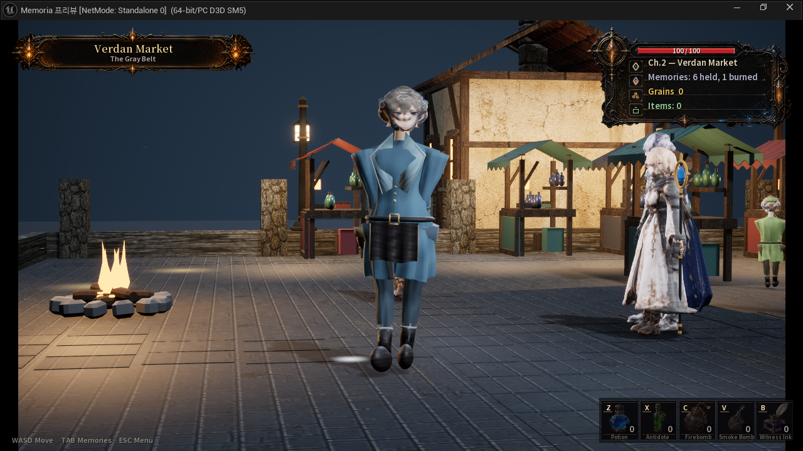
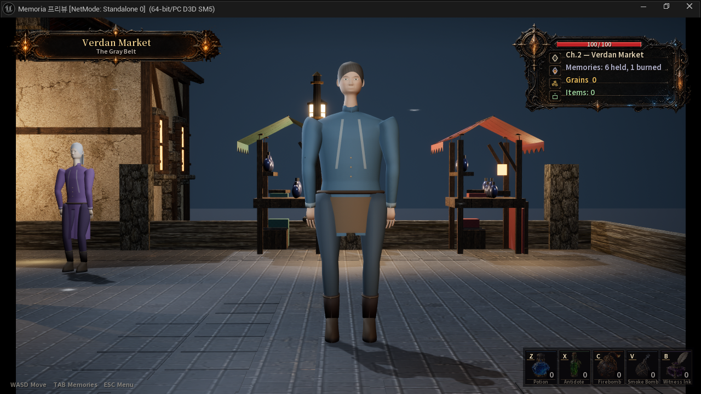
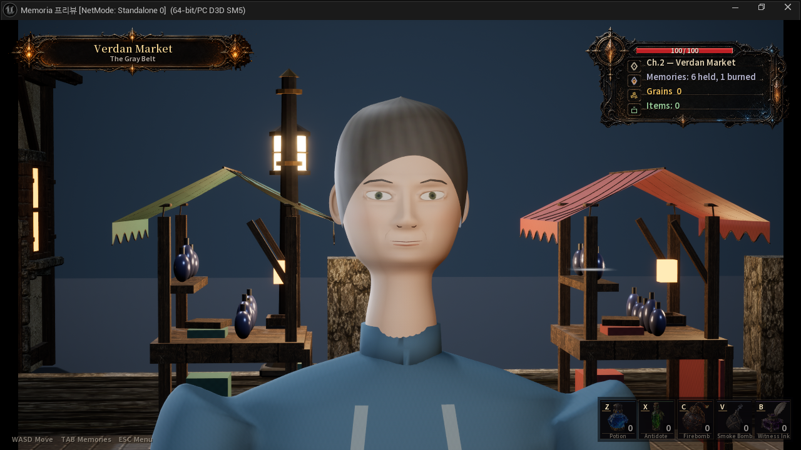
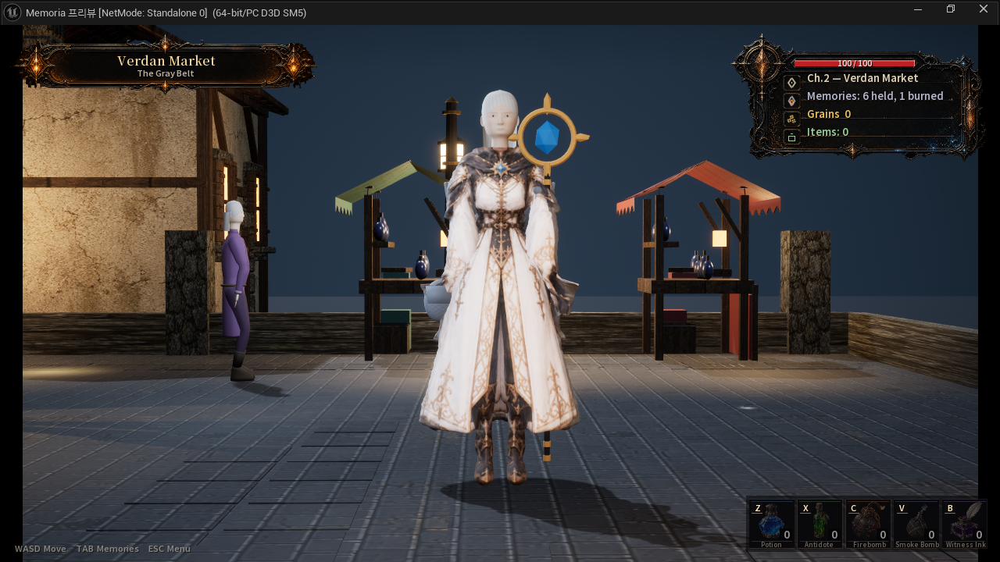
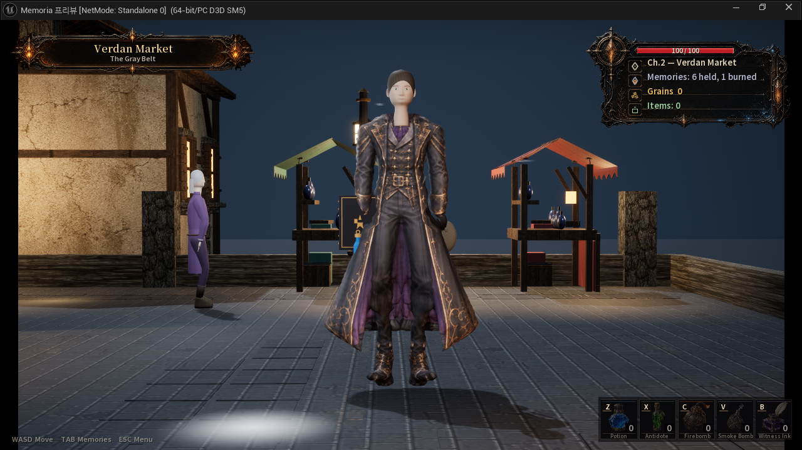

# S359 — NPC 얼굴·체형과 인간형 동작 개선

이전 S358 화면의 납작하고 큰 얼굴, 각진 체형, 몸 뒤로 접히는 팔 자세를 다시 다듬었습니다. 일반 NPC 9종은 얼굴과 몸체를 교체했고, 엘리아·말렛은 얼굴을 교체하면서 기존 의상 무늬를 유지했습니다. 실제 게임에 연결된 NPC 11종과 인간형 몬스터 두 계열의 새 동작 32개가 적용됩니다.

눈꺼풀·눈·코·입술·턱·귀·머리카락을 입체로 만들고 얼굴 폭과 머리 비례를 줄였습니다. 몸통과 어깨·소매는 이어지는 곡면으로 구성했고, 장화에는 밑창과 발등을 만들었습니다. 대기 자세에서 팔과 손이 옆으로 내려오며, 보행은 무게 이동과 반대 팔 움직임, 지면을 딛는 발과 들어 옮기는 발을 구분합니다. 정지 시 기존 블렌드를 통해 대기 자세로 복귀합니다.

**수정 전과 후 — 동일한 베르단 월드의 실제 캡처**

**실제 보행 영상** — 60 Hz 검증 중 3프레임마다 저장한 연속 원본 화면 41장을 20 fps로 인코딩했습니다. 이미지 수정이나 중간 프레임 생성은 없습니다.

- [NPC 보행](evidence/s359/final_FishermanWalk.mp4)
- [Ash Walker 보행](evidence/s359/final_AshWalkerWalk.mp4)
- [Belt Scavenger 보행](evidence/s359/final_BeltScavengerWalk.mp4)

**엘리아·말렛** — 새 얼굴과 원래 의상 무늬를 함께 확인했습니다.

**검증**

| 항목 | 실제 결과 |
| --- | --- |
| 최종 에디터 빌드 / 독립 legacy 임포트 | PASS / PASS |
| 화면 30 + Foundation 6 + NPC 검증 2 | 38/38 unique PASS, 36 success + 2 success with warnings |
| 엔진 종료 / 치명 오류 | exit 0 / 0 |
| 수정 후 동작 전용 검증 | 1/1 PASS; 최종 38개에 포함된 중복 항목 |
| 실제 이동 중 지지 발 위치 | 13종 모두 통과; 0.5cm 이동 틱당 최대 오차 0.075120cm |
| 새 에셋 | 메시 11 + 동작 32 + 재질 1 = 44 패키지; 텍스처 0 |
| 원본 / 실행 입력 | 기존 641 패키지, 최종 394 입력 해시 보존 |
| 원본 화면 증거 | 새 최종 캡처 447장 중 PNG 31장과 보행 영상 3개 저장 |

NPC 11종 얼굴 클로즈업, 대표 전신 6종, 최종 측면·보행 연속 화면, 인간형 몬스터 공격·사망 화면을 직접 검토했습니다. 모든 모델의 실제 지지 발 이동, 정지 복귀, 머리 크기, 스키닝·뼈·재질 연결을 검사했습니다. 엘리아·말렛 의상은 실제 원본 좌표와 UV 쌍을 비교합니다. 기존 전투 판정 시간과 이동 수치·충돌·저장·스토리·게임 카메라·조명은 유지됩니다.

초기 후보는 승인하지 않았습니다. R4는 상속된 흰색 색상 레이어를 언리얼이 먼저 읽었고, R5는 색상 정리 중 UV 소실과 발 접촉 속도 불연속이 있었습니다. 원본과 실패 실행·캡처·소스를 Saved에 보존했습니다. R6는 단일 색상 레이어와 UV를 FBX 재읽기 및 실제 언리얼 버퍼에서 검사하고, 지지 구간과 발 옮기기 구간의 속도를 연속으로 연결한 별도 최종 후보입니다. 최초 빌드의 변수명 충돌도 수정 후 새 빌드로 검증했습니다.

얼굴은 여전히 스타일화되어 있으며 공통 기본 형태를 사용합니다. 나이별 표현은 제한적이고, 눈 깜박임·표정 애니메이션은 이번 범위에 없습니다. 엘리아·말렛의 기존 의상 원본에는 일부 스캔 형상 흔적이 남습니다. 비치명 시작 조건·메모리 예산 및 기존 API 경고는 결과 기록에 남겼습니다. 전체 274개 레지스트리, Shipping, 새 LOD, 장시간 성능 검증은 이번 결과에 포함하지 않습니다.

로컬 작업 커밋만 수행합니다. 상세 로그·해시·실제 실행 명령·경고·전후 이미지 출처는 [S359_RESULTS.json](S359_RESULTS.json), 재생성 규칙은 [원본 README](../../Unreal/ArtSource/HumanoidNaturalS359/README.md)에 있습니다.
