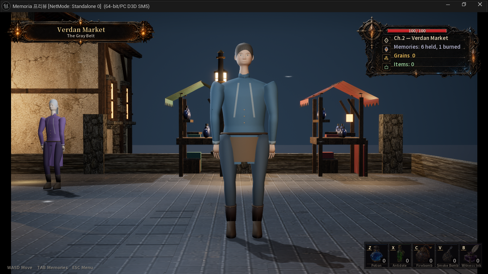
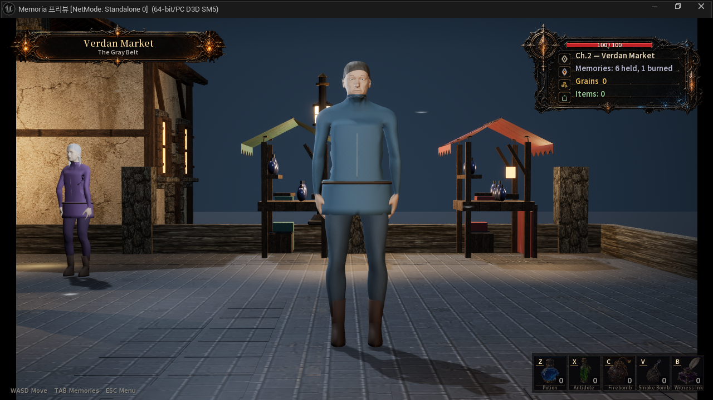
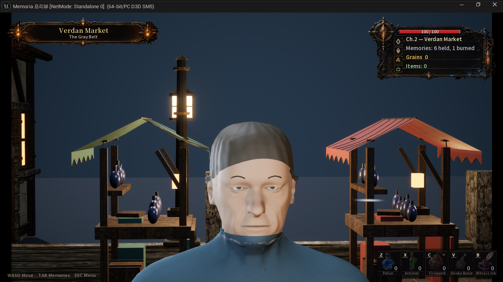
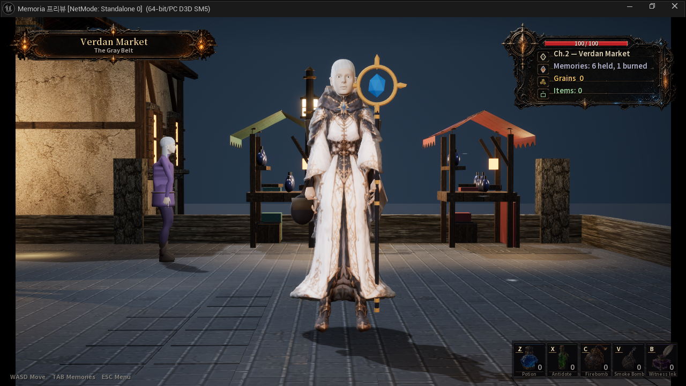
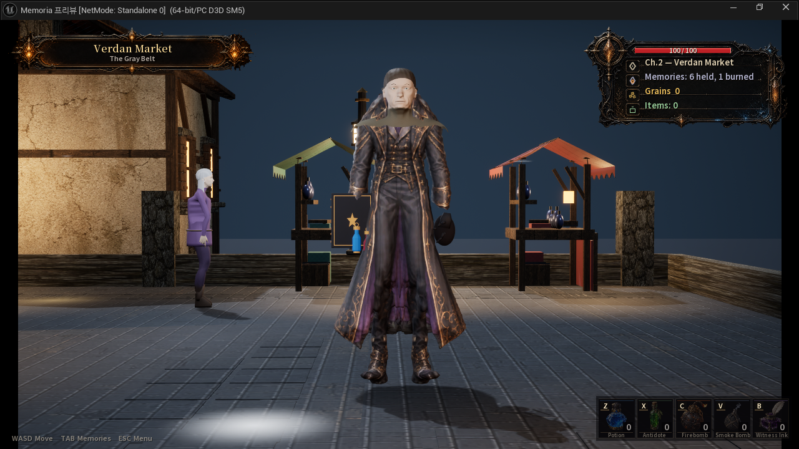
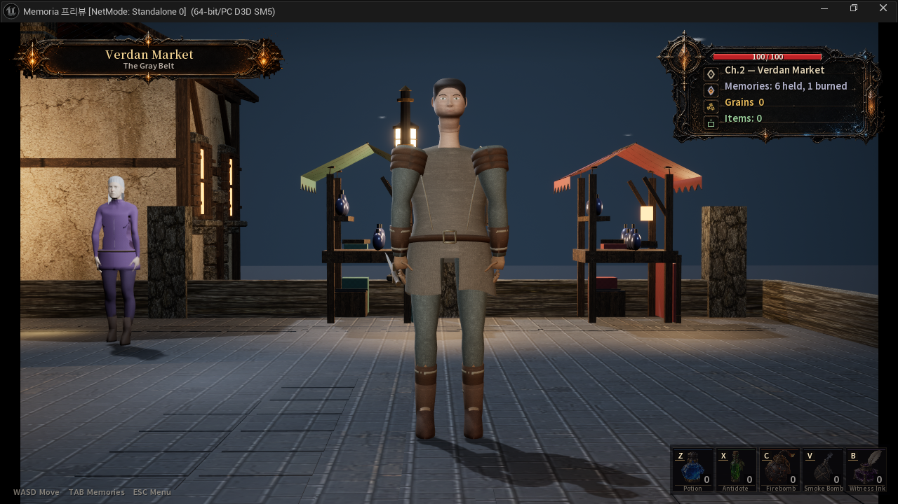

# S360 — 사람의 비례로 NPC 체형과 인간형 동작 재구성

이전 S359의 긴 목, 원통형 몸통, 각진 어깨와 가는 골반을 사람의 연속된 기본 형태로 교체했습니다. 일반 NPC 9종의 몸과 NPC 11종의 얼굴을 다시 만들고, 엘리아·말렛은 기존 의상의 무늬와 UV를 유지하면서 새 어깨·팔·골반 관절에 맞췄습니다. 인간형 몬스터 두 계열도 관절 위치와 장화를 정리하고 머리와 몸 사이의 실제 목 연결을 보강했습니다.

**수정 전과 후 — 언리얼 실제 화면**

어깨·가슴·허리·골반과 팔꿈치·무릎을 실제 사람 형태에 맞춰 재배치했습니다. 손과 손가락, 코·입술·눈꺼풀·귀는 연속된 인간 기본 메시에서 가져옵니다. 나이·성별 형태를 적용했으며, 아이는 별도 머리 비례와 보폭을 사용합니다. 팔이 몸 옆으로 내려오고 보행 시 골반·상체·반대 팔이 움직이며, 지면을 딛는 발과 들어 옮기는 발을 구분합니다.

**원본 화면으로 만든 보행 영상** — 60 Hz 이동 검증 중 3프레임마다 저장한 연속 원본 41장을 20 fps로 인코딩했습니다. 픽셀 수정·프레임 보간은 없습니다.

- [NPC 보행](evidence/s360/final_FishermanWalk.mp4)
- [Ash Walker 보행](evidence/s360/final_AshWalkerWalk.mp4)
- [Belt Scavenger 보행](evidence/s360/final_BeltScavengerWalk.mp4)

최종 구성은 R7 NPC 메시 11개와 독립 스켈레톤 13개, R8 몬스터 동작 10개, R9 엘리아 전투 동작 7개, R10 몬스터 메시 2개, R7 NPC 대기·보행 22개와 재질 1개입니다. 총 66개 새 패키지이며 새 텍스처는 없습니다. 77개 뼈의 이름·계층은 유지하되, 잘못된 기존 관절 위치는 새 인체 비례로 바꿨습니다. 새 동작 39개가 새 바인드에 맞습니다. 엘리아의 공격·차지·대시·피격·사망과 몬스터 동작은 각각 원래 전투 프레임 수와 길이에 맞춰 임포트합니다.

| 검증 | 실제 결과 |
| --- | --- |
| 최종 에디터 빌드 / R10 legacy 임포트 | PASS / PASS |
| 화면 30 + Foundation 6 + 현재 체형·동작 검사 3 | 39/39 unique PASS; 37 success + 2 success with warnings |
| 엔진 종료 / 치명 오류 | exit 0 / 0 |
| 실제 이동 중 지지 발 | 13종 모두 통과; 0.5cm 이동 틱당 최대 오차 0.077081cm |
| 몬스터 목 접합 | 실제 포즈 20개에서 얼굴·목과 몸의 높이 영역 중첩 확인 |
| 원본 보존 / 최종 실행 입력 | 기존 685 패키지 / 475 입력 해시 보존 |
| 증거 | 새 캡처 447장; 선택한 최종 PNG 30장, 이전 PNG 1장, 보행 영상 3개 |

NPC 11종과 몬스터 두 계열의 전신, 대표 얼굴·측면·연속 보행과 몬스터 공격·사망, 엘리아 기술 화면을 직접 확인했습니다. 초기 R9 엘리아 측면 캡처 1장은 지나가는 월드 캐릭터에 가려져 측면 증거에서 제외했고, 어부·아이·몬스터 측면을 기록했습니다. 실제 의상 UV 코너 99% 이상 보존, 원래 페인트 재질 연결, 스키닝·관절 순서·색상 버퍼·회복 후 보행을 검사했습니다. 게임 높이·이동 수치·충돌·전투 판정 시간·저장·스토리·게임 카메라·조명은 유지합니다.

실패 결과를 통과로 계산하지 않았습니다. R1–R6 형태·UV·색상 후보, R7 분리된 몬스터 목, R8 잔여 목 틈과 초기 39개 중 4개 실패를 보존했습니다. R9는 실제 목을 이어 붙였지만 추가 목 UV가 얼굴 재질 범위를 벗어났고, 정지 갱신이 함께 실행되는 피격 검사에서 보행 비중 95%를 요구해 2개가 실패했습니다. R10은 새 목 UV를 0–1에 명시적으로 매핑하고, 검사는 주기 순환을 포함한 실제 위상 변화와 보행 활성화를 확인합니다. 자연스러운 피격 종료 후 실제 관절 움직임 검사는 그대로 남습니다. 거절한 R7/R8/R9 몬스터 패키지는 Content 밖 검증 폴더에 보관했습니다.

새 인간 기본 메시와 나이·성별 타깃은 공식 MakeHuman 저장소의 고정 커밋에서 가져온 CC0 그래픽 자산입니다. 프로그램 코드는 포함하지 않습니다. [출처·라이선스·재생성 안내](../../Unreal/ArtSource/HumanoidAnatomyS360/README.md).

아직 단순화된 게임용 표현입니다. 일반 NPC 의상은 평면 색상이 많고, 얼굴 기본 형태가 공통이며 머리카락도 단순합니다. 옷깃·겨드랑이 일부 주름과 기존 주연 의상의 스캔 흔적, 몬스터의 스타일화된 갑옷·얼굴과 목 접합부의 표면 단차가 남습니다. 표정·눈 깜박임·머리카락 물리·피부 텍스처 페인팅은 이번 범위에 없습니다. 기존 시작 시 자동 검사 진단과 API·메모리 예산 경고는 원본 로그와 결과에 기록했습니다. 전체 274개 검사·Shipping·새 LOD·장시간 성능 검증을 완료했다는 의미는 아닙니다.

자세한 명령·해시·실패 이력·경고·직접 확인한 화면은 [S360_RESULTS.json](S360_RESULTS.json)에 있습니다. 로컬 작업 커밋만 수행하며 원격 푸시·배포·다른 작업 트리 변경은 없습니다.
