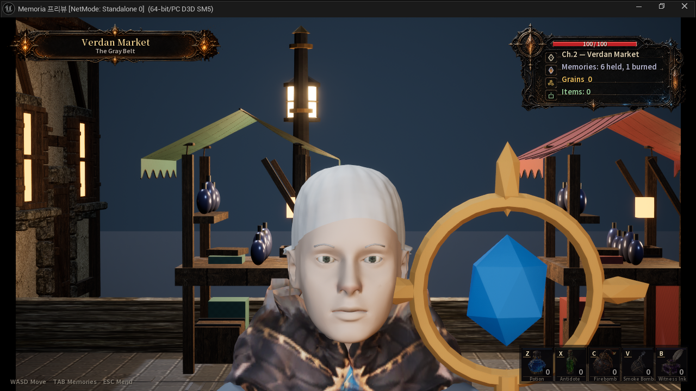
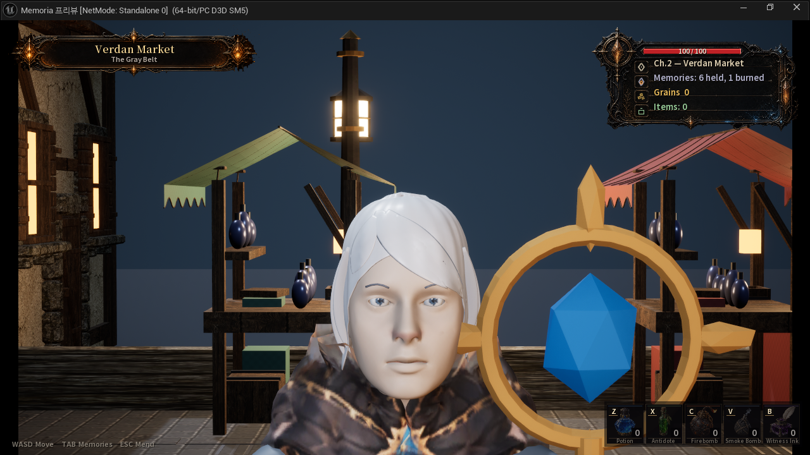
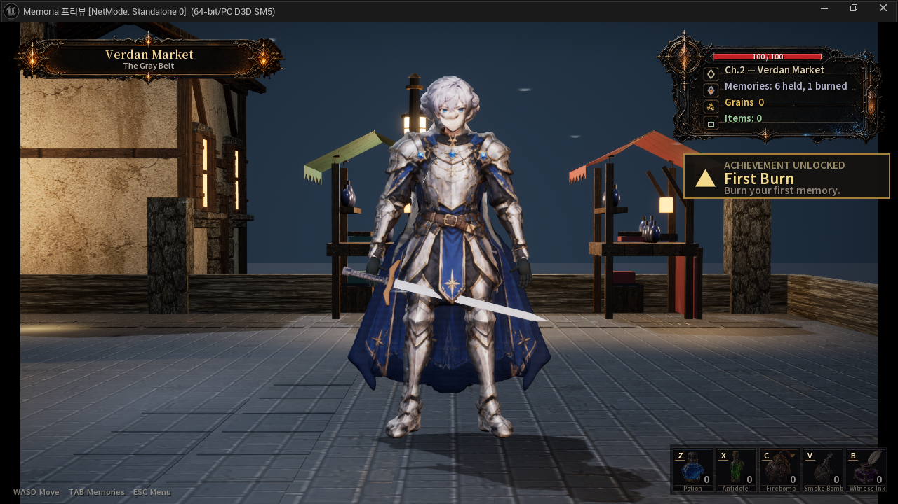
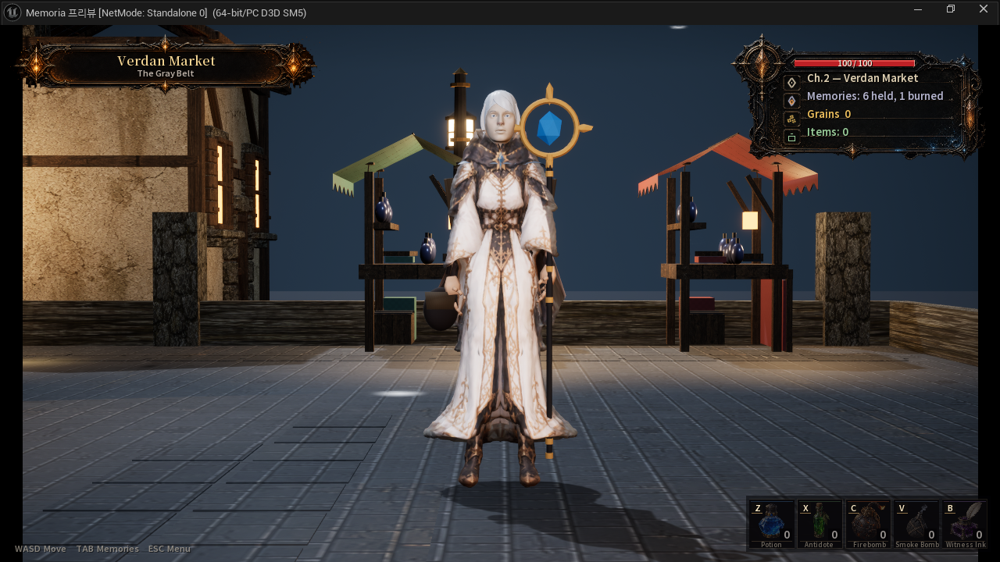

# S361 — 아렐·엘리아 주인공 그래픽 보강

실제로 플레이어와 동행자로 표시되는 아렐·엘리아를 다듬었습니다. 아렐의 은발·푸른 눈·남색과 은색 갑옷, 엘리아의 흰 머리와 원래 로브 무늬를 유지합니다. 아렐은 흉갑·견갑·소맷단의 입체 테두리와 연결 장식, 보석을 보강했습니다. 엘리아는 눈동자·눈꺼풀 주변과 입술·볼의 색, 사선 앞머리·곡선 옆머리·겹친 뒷머리를 개선했습니다.

**엘리아 얼굴 — 같은 언리얼 카메라의 수정 전과 후**

**아렐 전신 — 원래 얼굴과 의상을 살린 갑옷 보강**

원본 의상의 모든 좌표·UV·스킨 가중치를 보존합니다. 새 테두리와 장식에는 천·머리카락·금속·보석을 구분하는 새 재질을 적용하고, 엘리아 얼굴에는 별도 색상·미세 표면 재질을 적용했습니다. 새 텍스처·스켈레톤·애니메이션은 없습니다. R4 신규 패키지는 메시 2개와 재질 2개입니다. 원래 77개 뼈와 바인드·동작·검과 지팡이 연결을 유지합니다. 게임 높이는 아렐150·엘리아138이며 이동·충돌·판정 시간·저장·스토리·게임 카메라·조명은 유지됩니다.

**실제 보행 화면으로 만든 영상** — 60Hz 검증에서 3프레임마다 저장한 원본41장씩을 20fps로 인코딩했습니다. 픽셀 수정·프레임 보간은 없습니다.

- [아렐 보행](evidence/s361/final_ArrelWalk.mp4)
- [엘리아 보행](evidence/s361/final_EliaWalk.mp4)

| 검증 | 실제 결과 |
| --- | --- |
| 최종 에디터 빌드 / R4 legacy 임포트 | PASS / PASS |
| 화면30 + Foundation6 + S358–S361 | 40/40 unique PASS; 38 success + 2 success with warnings |
| 엔진 종료 / 치명 오류 | exit0 / 0 |
| 원래 의상 좌표·UV·가중치 | 소스 좌표·UV·가중치100% 보존; 네이티브 위치·UV 코너 일치 아렐25743/25743, 엘리아25155/25155 |
| 원본 패키지 | 751개 해시 보존 |
| 실제 전투 동작 | 요청 역할15개, 실제 CPU 스키닝45시점, 비사망13개 자연 회복과 사망2개 유지 |
| 기존 동작 호환성 | 전투 역할21회(중복 매핑 포함) 및 Idle/Walk4개, 뼈별9시점 검사 |
| 새 검증 입력 | 286개 컴파일 소스와 297개 최종 실행 입력 해시 보존 |
| 증거 | 새 최종 캡처561장, 선택 PNG24장과 보행 영상2개 |

실제 공유 필드 캐릭터 컴포넌트로 전신·얼굴·측면·뒷면·연속 보행과 공격·피격·사망을 확인했습니다. 아렐 방어도 정면과 별도 각도로 확인했습니다. 검·지팡이의 손 부착 변환과 잡는 위치를 검사하지만, 무기와 몸의 기하학적 관통이나 발 미끄러짐 제거를 인증하는 검사는 아닙니다. 방어는 비유지 동작 표본이며 실제 전투의 방어 유지 수명주기를 검증한 것은 아닙니다. Heavy_Combo는 호환성 검사에 포함되지만 별도 실제 재생 장면은 없습니다.

실패·거절 결과는 최종 통과에 합산하지 않습니다. R1은 엘리아 메시 재구성 오류로 실패했습니다. R2는 아렐 정수리 갈고리와 엘리아의 반듯한 앞머리를 시각적으로 거절했습니다. 초기 검사가 실제 런타임에서 쓰지 않는 손상된 옛 HitReact를 직접 불러오고, 정상적인 수평 Knockback 포즈에 직립 높이를 요구한 오류는 기존 모델에서도 재현했습니다. 검사는 실제 ForAction 매핑과 해당 클립 후기의 제한된 수평 판정으로 고쳤으며, 원래 동작 파일은 수정하지 않았습니다. R3는 자동검사에 통과했지만 엘리아 뒷머리의 긴 돌출선을 실제 화면에서 발견해 거절했습니다. R4는 두께 처리의 날카로운 가장자리의 과도한 두께 확장을 제거하고, 수정 전후·FBX 왕복의 머리카락 국소 범위와 원래 XY 경계, 임포트 경계를 검사합니다. 이전 후보는 Content·ArtSource 밖 Saved 검증 폴더에 해시와 함께 보관합니다.

아직 단순화된 게임용 표현입니다. 아렐의 원래 페인트 얼굴과 머리 형상, 얼굴 표면의 단차·스캔 흔적을 유지했습니다. 엘리아는 공통 인체 얼굴 형태를 기반으로 하며 뒷머리 끝 간격이 규칙적입니다. 기존 의상 주름·갑옷의 스캔 흔적, 일부 검·망토 교차, 단순한 칼날과 지팡이가 남습니다. 표정·눈 깜박임·머리카락 물리·피부 텍스처 페인팅은 이번 범위에 없습니다. 시작 시 엔진 조건 진단15줄과 비치명 API·메모리 예산 경고는 원본 로그와 결과에 기록합니다. 전체274개 검사·Shipping·새 LOD·장시간 성능 검증 완료를 의미하지 않습니다.

[소스·재생성 안내](../../Unreal/ArtSource/HeroPolishS361/README.md), [명령·해시·실패 이력·검토 기록](S361_RESULTS.json). 로컬 작업 커밋만 수행하며 원격 푸시·배포·다른 작업 트리 변경은 없습니다.
